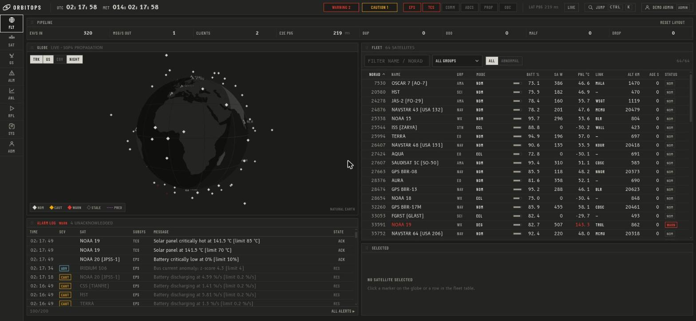
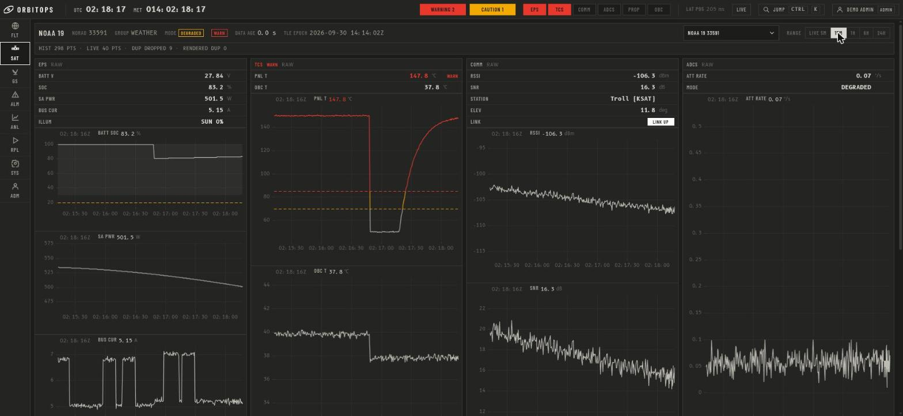
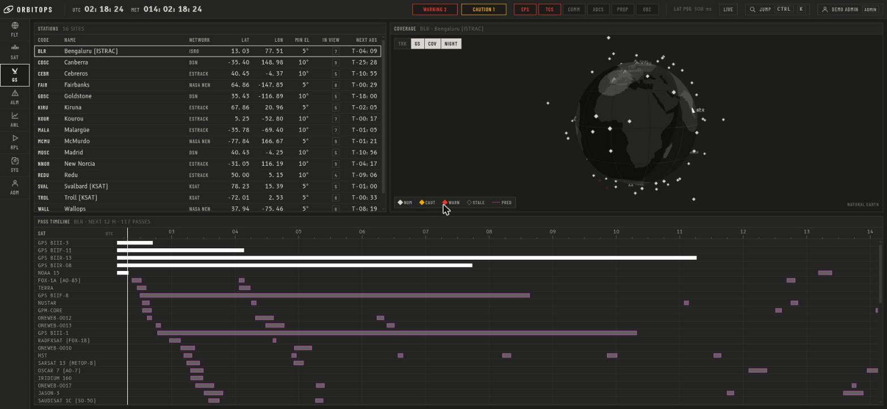
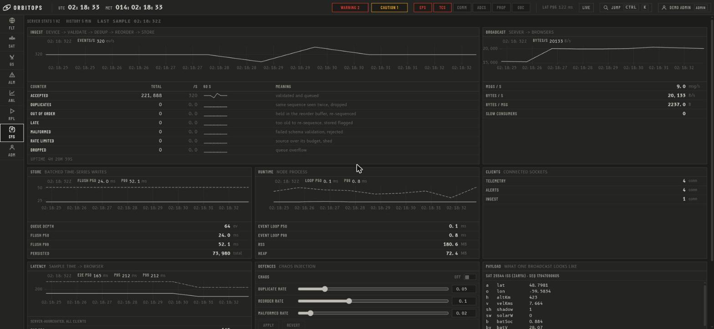
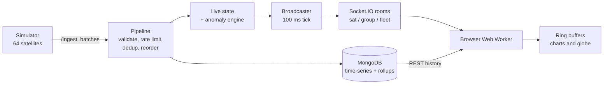

# OrbitOps


Real-time satellite mission control, built on the MERN stack and Socket.IO for the MERNIFY hackathon
(High-Throughput Streams & Telemetry track).



## What it is

OrbitOps monitors a fleet of 64 satellites, including the ISS, GPS, NOAA weather and Iridium spacecraft, from one
browser console. The satellites fly **real orbits** from published orbital elements, and their telemetry (battery,
solar power, temperatures, radio link, attitude) is **physics-driven**: it follows the satellite's real position,
sunlight and eclipse, and which of 16 real ground stations can see it. Telemetry streams into a Node server that
validates, de-duplicates, stores and broadcasts it. Browsers receive only the updates they subscribed to, in a
compact binary format, and draw them without stalling.

Live demo: _not deployed yet_ (see [Hosting](#bonus-items-in-the-problem-statement) and
[docs/DEPLOYMENT.md](docs/DEPLOYMENT.md)).

## The problem

The brief asks for a platform that ingests continuous high-frequency telemetry from many sources, keeps system
state, stores history, and shows live changes to several users at once, without duplicates, lag or runaway
rendering. Satellite operations is a natural fit: dozens of sources, steady data, abnormal events that matter
immediately, and a real convention (alarms, annunciators, ground-station passes) for how operators want to see it.
OrbitOps turns that into a working system you can poke at, break on purpose, and measure.

## Try it in 3 steps

Prerequisites: **Node 24 or newer** and **Docker** (for MongoDB).

```bash
# 1. Install and start MongoDB (single-node replica set, in Docker)
npm install
npm run db:up

# 2. Create the two .env files (both carry the same development device key)
cp packages/server/.env.example packages/server/.env
cp packages/simulator/.env.example packages/simulator/.env

# 3. Run the server, the simulator and the web app together
npm run dev
```

Open <http://localhost:5173> and sign in with a demo account (password `orbitops` for all three):

| Account                 | Role     | Can do                                                          |
| ----------------------- | -------- | --------------------------------------------------------------- |
| `viewer@orbitops.dev`   | viewer   | Watch everything, browse history and replay                     |
| `operator@orbitops.dev` | operator | Everything above, plus acknowledge alarms and inject faults     |
| `admin@orbitops.dev`    | admin    | Everything above, plus users, device keys, rules and chaos mode |

The first start seeds the satellites, ground stations, alert rules and these accounts. Give the simulator a minute
and the fleet table fills in.

**Everything in Docker, one command** (builds the app, starts MongoDB, the server and the simulator):

```bash
JWT_SECRET=$(openssl rand -hex 32) DEVICE_API_KEY=dev-simulator-key-change-me \
  docker compose -f docker-compose.yml -f compose.app.yml up --build
```

Then open <http://localhost:4000>. To host it for others (Render plus MongoDB Atlas free tier), follow
[docs/DEPLOYMENT.md](docs/DEPLOYMENT.md).

## What you can do

A five-minute tour. Two browser windows, one signed in as the operator and one as the viewer, makes it more fun.

**Watch the fleet.** The Fleet page shows every satellite on a globe, in a sortable table, and in the alarm log.
The console bar carries the clocks, master WARNING and CAUTION lamps, subsystem lamps and the measured
event-to-screen latency.

**Inject a fault and watch the alarms fire.** Open a satellite, pick a fault in the Commands panel (battery,
thermal, tumble or comms) and confirm. The trace leaves its normal band and turns amber, then red as limits
are crossed; the lamps flash until someone acknowledges; the viewer's window shows the same alarms without a refresh.



**Switch history ranges.** The range selector goes from the live five-minute window to 24 hours. Longer ranges
load history from MongoDB and join it to the live stream at a sequence-number watermark, so the seam shows no
duplicated and no missing points. The page header counts history points, live points and duplicates dropped.

**Replay the last six hours.** The Replay page scrubs the globe and the charts through recent history, with
play, pause and speed controls, and marks the app as REPLAY while you do.



**Break it on purpose.** As admin, open the System page and switch on chaos mode. The simulator starts sending
duplicate, out-of-order and malformed events; the counters climb while the charts stay clean.



Also: an analytics page with a fleet heatmap and a study of one satellite against its own 24-hour baseline,
an alarm log with filters and tunable rules, and a command palette on `Ctrl+K` (or `Cmd+K`) to jump to any
satellite. Page hotkeys are `g` then `f`, `s`, `g`, `a`, `n`, `r`, `y` or `d`.

## Features

Mapped to the hackathon brief.

**Ingestion**

- [x] Simulated devices push batches over a dedicated Socket.IO `/ingest` namespace and wait for an acknowledgement.
- [x] Several sources at once: every satellite is its own source, and the simulator can be split across processes.
- [x] Each event carries `sourceId`, a per-source sequence number `seq` and a timestamp `ts`.

**Processing**

- [x] Staged pipeline: validate, rate limit, de-duplicate, reorder, then update state and run anomaly detection.
- [x] Live state per satellite, with only changed fields tracked for broadcasting.

**Storage**

- [x] MongoDB time-series collection for raw telemetry, plus one-minute rollups (avg, min, max) for long ranges.
- [x] Batched, bounded writes so a slow database never blocks live delivery.

**Real-time broadcast**

- [x] Socket.IO namespaces (`/telemetry`, `/alerts`, `/ingest`) and rooms (`sat:`, `group:`, `fleet`, `system`).
- [x] Per-room rates, per-client rate choice, compact binary deltas, slow-consumer protection.

**Visualisation**

- [x] 3D globe, dense tables, strip charts, heatmap, pass timeline, system dashboard and replay.

**History and live together**

- [x] History from MongoDB joined to the live stream at a watermark: no duplicates, no seams.

**Responsiveness**

- [x] Socket work in a Web Worker, ring buffers, one animation-frame loop, windowed and downsampled charts.

**Validation and rate limiting**

- [x] Strict zod schemas on every input, per-device token bucket, login throttling, request limits.

**Auth and roles**

- [x] JWT in httpOnly cookies, three roles enforced on the server, hashed device API keys for producers.

**Anomaly detection and alerts**

- [x] Threshold, rate-of-change and rolling z-score detectors with hysteresis; acknowledge and resolve workflow.

### Bonus items in the problem statement

| Bonus item in the brief                     | How OrbitOps covers it                                                                                                                | More                                                    |
| ------------------------------------------- | ------------------------------------------------------------------------------------------------------------------------------------- | ------------------------------------------------------- |
| High-frequency streams, low latency         | Up to 10 samples per second per satellite, 100 ms batches, bounded queues; end-to-end latency is measured and shown live              | [REALTIME.md](docs/REALTIME.md)                         |
| Efficient WebSocket payloads                | Deltas of changed fields only, 1-2 character keys, fixed rounding, MessagePack framing, and a 1 Hz nine-field feed for the fleet view | [REALTIME.md](docs/REALTIME.md#delta-encoding)          |
| Client-side batching, throttling, windowing | Worker posts a batch every 50 ms, per-panel frame-rate caps, ring buffers, downsampling (LTTB) for long ranges                        | [REALTIME.md](docs/REALTIME.md)                         |
| Independent subscriptions per client        | Each browser subscribes to its own rooms and rate; the viewer and operator windows can watch different satellites                     | [API.md](docs/API.md#socketio)                          |
| Historical analysis alongside live          | Analytics heatmap, satellite study against a 24-hour baseline, battery-versus-eclipse regression, six-hour replay                     | [ARCHITECTURE.md](docs/ARCHITECTURE.md)                 |
| Anomaly detection and alerts                | Spacecraft rules plus z-score and rate-of-change detectors, hysteresis and cooldown, annunciators, toasts and optional sound          | [SIMULATION.md](docs/SIMULATION.md#faults-and-commands) |
| Backpressure, rate limiting, protection     | Token bucket per device, `retryAfterMs` in the ack, bounded queues, slow-consumer downgrade and kick, chaos mode to prove it          | [SECURITY.md](docs/SECURITY.md)                         |
| Performance measurements and stress tests   | A load-test tool for ingest floods and client swarms, with results written up                                                         | [PERFORMANCE.md](docs/PERFORMANCE.md)                   |
| Hosting on Render, Railway, Vercel or AWS   | Render blueprint (`render.yaml`) with MongoDB Atlas M0; the simulator runs embedded so one free service is enough. Not deployed yet.  | [DEPLOYMENT.md](docs/DEPLOYMENT.md)                     |

Live demo: _not deployed yet_

## How it works



**Data generation.** There is no hardware, so a simulator process flies 64 real satellites. Their orbits come from
real two-line element sets (TLEs) from [CelesTrak](https://celestrak.org), propagated with the SGP4 model in
satellite.js. Sun position and a shadow model decide when each satellite is in eclipse, and that drives the
battery, solar power and temperature physics. Radio link quality comes from the real geometry to 16 real ground
stations. Operators can inject faults (battery, thermal, tumble, comms), and an admin can turn on chaos mode to
send duplicates, out-of-order and malformed events. Details: [docs/SIMULATION.md](docs/SIMULATION.md).

**Ingestion pipeline.** Each satellite sends batches of up to 500 events every 100 ms and waits for an ack. The
server validates each event, applies a per-device rate limit, drops duplicates using a window of recent sequence
numbers, and puts events back in order using a short reorder buffer. Clean events then update the live state, feed
the anomaly engine and go into a bounded writer queue that inserts into MongoDB in batches. The ack tells the
producer how many events were accepted, and asks it to slow down when the server is under pressure. Details:
[docs/ARCHITECTURE.md](docs/ARCHITECTURE.md#data-flow).

**Real-time communication.** Socket.IO has three namespaces: `/ingest` for producers, `/telemetry` for browsers and
`/alerts` for alarm events. Browsers join rooms: `sat:<id>` gets up to 10 Hz, `group:<name>` 2 Hz, `fleet` 1 Hz with
nine fields, `system` the pipeline stats. A single 100 ms tick drains the changed fields once and feeds every room,
so cost grows with rooms, not with clients. Messages are compact MessagePack deltas. A client that falls behind is
first downgraded to the 1 Hz feed, then disconnected. For history, the server returns the last sequence number it
read, and the browser drops any live event at or below that watermark. Details:
[docs/REALTIME.md](docs/REALTIME.md).

**Client performance.** The socket lives in a Web Worker that decodes, merges and de-duplicates, then posts one batch
every 50 ms. The main thread appends to fixed-size ring buffers and a single `requestAnimationFrame` loop redraws
each chart only when its data changed and at its own rate cap. Components subscribe through a reference-counted
manager, so navigating pages never causes subscription churn.

## Tech stack

| Layer          | Technology                                              | Version           |
| -------------- | ------------------------------------------------------- | ----------------- |
| Runtime        | Node.js, npm workspaces                                 | 24+               |
| Language       | TypeScript (strict, ES modules everywhere)¹             | 6.0               |
| Server         | Express                                                 | 5.3               |
| Real time      | Socket.IO (server and client), MessagePack parser       | 4.8               |
| Database       | MongoDB (replica set), Mongoose                         | 8 / 9.12          |
| Validation     | zod                                                     | 4.6               |
| Auth           | jose (JWT), @node-rs/argon2, helmet, express-rate-limit | 6.2 / 2.2         |
| Orbits         | satellite.js (SGP4)                                     | 7.2               |
| Frontend       | React, React Router, Vite                               | 19.3 / 8.5 / 8.3  |
| Styling        | Tailwind CSS (tokens only, no default palette)          | 4.3               |
| Charts and map | uPlot, Apache ECharts, deck.gl (globe view)             | 1.6 / 6.1 / 9.4   |
| Client state   | TanStack Query, Zustand, Comlink (Web Worker)           | 5.107 / 5.1 / 4.4 |
| Testing        | Vitest, Supertest, mongodb-memory-server                | 5.1 / 7.3 / 11.3  |
| Deployment     | Docker, Render blueprint, MongoDB Atlas M0              | -                 |

¹ Every dependency is on its latest stable release except TypeScript, which stays on 6.0 because
typescript-eslint 8 does not support the new TypeScript 7 compiler yet.

## Running tests

```bash
npm test                          # every package
npm test -w @orbitops/server      # one package (shared, server, simulator, web)
npm run lint && npm run typecheck
```

The suites cover the shared contracts and codec, every ingest stage, anomaly detectors, storage and rollups, the
backpressure guard, auth, the simulator physics and transport, and the client real-time layer. Two integration tests
start a real server against a real MongoDB replica set (an in-memory one is downloaded on first run, or point
`TEST_MONGODB_URI` at the Docker one). GitHub Actions runs lint, typecheck, tests and the web build on every push.
What each suite covers, plus a manual checklist for roles, faults and chaos mode, is in
[docs/TESTING.md](docs/TESTING.md).

**Load tests.** The [tools/loadtest](tools/loadtest) workspace floods the ingest endpoint and runs swarms of viewer
clients, and records events handled, clients connected, latency and bandwidth.

<!-- PERF-SUMMARY -->

Measured on one laptop (Ryzen 7 7735HS, 16 threads; server, MongoDB and load generators sharing it), 30 s per run:

| Scenario                                         | Result                                                                                        |
| ------------------------------------------------ | --------------------------------------------------------------------------------------------- |
| Realistic: 64 satellites at 10 Hz, 1,000 viewers | 639 ev/s ingested, 2,091 msgs/s delivered, end-to-end p95 145 ms, server CPU 19 % of a core   |
| 64 satellites at 10 Hz, 10,000 viewers           | all 10,000 connected, 19,184 msgs/s delivered, p95 320 ms, 0 drops                            |
| Ingest ceiling (100 viewers)                     | ~80,000 acknowledged events/s before ack p99 passes 250 ms (single Node process)              |
| Flood at default limits                          | throughput held at the per-device budget, excess rejected with `retryAfterMs`, server healthy |
| Stalled client                                   | downgraded, then kicked; the other 100 clients unaffected                                     |

Method, raw numbers and limitations: [docs/PERFORMANCE.md](docs/PERFORMANCE.md).

<!-- /PERF-SUMMARY -->

## Project structure

```text
packages/
  shared/      contracts: zod schemas, event names, rooms, delta codec, MessagePack parser
  server/      Express 5 + Socket.IO + Mongoose: ingest pipeline, state, anomalies, storage, auth, REST
  simulator/   64 virtual satellites: SGP4 orbits, physics, faults, chaos mode
  web/         React 19 app: Grey Room UI, real-time layer (Web Worker), globe and charts
tools/
  loadtest/    ingest flood, viewer swarm, scenario runner
data/          committed snapshot of real TLEs and 16 ground stations
docs/          architecture, real-time, data model, API, security, deployment, testing, design
Dockerfile, docker-compose.yml, compose.app.yml, render.yaml
```

## Documentation

| Document                                     | What is in it                                              |
| -------------------------------------------- | ---------------------------------------------------------- |
| [docs/README.md](docs/README.md)             | Index, and where the brief's design-document items live    |
| [docs/ARCHITECTURE.md](docs/ARCHITECTURE.md) | Architecture and data-flow diagrams, key design decisions  |
| [docs/REALTIME.md](docs/REALTIME.md)         | Rooms, rates, delta encoding, backpressure, history + live |
| [docs/DATA_MODEL.md](docs/DATA_MODEL.md)     | Collections, fields, indexes, TTLs, duplicate handling     |
| [docs/API.md](docs/API.md)                   | REST endpoints and Socket.IO events                        |
| [docs/SIMULATION.md](docs/SIMULATION.md)     | What is real, what is modelled, faults, chaos mode         |
| [docs/SECURITY.md](docs/SECURITY.md)         | Auth, roles, validation, rate limits, known limitations    |
| [docs/DEPLOYMENT.md](docs/DEPLOYMENT.md)     | Local, Docker and Render setup, every environment variable |
| [docs/TESTING.md](docs/TESTING.md)           | Test suites, CI, manual demo checks                        |
| [docs/PERFORMANCE.md](docs/PERFORMANCE.md)   | Load-test method and results                               |
| [docs/DESIGN.md](docs/DESIGN.md)             | The Grey Room UI design system                             |
| [docs/DEMO_SCRIPT.md](docs/DEMO_SCRIPT.md)   | Script for the demo video                                  |

## Credits and attribution

**AI assistance.** Built with AI coding assistance; all code reviewed and understood by the author.

**Data and resources**

| Resource                                                      | Use                                                                                             | Licence / terms                               |
| ------------------------------------------------------------- | ----------------------------------------------------------------------------------------------- | --------------------------------------------- |
| [CelesTrak](https://celestrak.org) GP data, Dr. T.S. Kelso    | Two-line element sets for the 64 satellites, retrieved through the tle.ivanstanojevic.me mirror | Public data, credited to the publisher        |
| [Natural Earth](https://www.naturalearthdata.com) 1:110m land | Land polygons drawn on the globe                                                                | Public domain                                 |
| Ground-station locations                                      | 16 real sites (KSAT, ESTRACK, NASA NEN, DSN, ISRO), approximate public coordinates              | Public information, compiled for this project |
| [B612](https://github.com/polarsys/b612) and B612 Mono        | UI fonts, designed by Airbus with the Paris Design Lab, via Fontsource                          | SIL Open Font License 1.1                     |
| [Barlow Condensed](https://github.com/jpt/barlow)             | Label font, via Fontsource                                                                      | SIL Open Font License 1.1                     |
| MongoDB Community Server 8                                    | Database, run from the official `mongo:8` Docker image                                          | SSPL                                          |

Telemetry values are synthetic; they are not real spacecraft telemetry. Satellite names and orbital elements belong
to their original publishers and are used here for visualisation only.

**Design influences (inspiration only, no code or assets taken):** the ISA-101 human-machine-interface guidance
(grey is normal, colour means abnormal), FAA and Airbus cockpit alerting conventions, and NASA Open MCT as a
reference for what mission-control software shows. See [docs/DESIGN.md](docs/DESIGN.md).

**Libraries.** Versions are the ones installed in this repository.

_Server, simulator and shared_

| Library                                                                                                        | Purpose                                    | Licence       |
| -------------------------------------------------------------------------------------------------------------- | ------------------------------------------ | ------------- |
| [Express](https://expressjs.com) 5.3                                                                           | HTTP server and routing                    | MIT           |
| [Socket.IO](https://socket.io) 4.8 (server and client)                                                         | Real-time transport, rooms, namespaces     | MIT           |
| [@socket.io/component-emitter](https://github.com/socketio/emitter) 3.1                                        | Event emitter for the custom parser        | MIT           |
| [@msgpack/msgpack](https://github.com/msgpack/msgpack-javascript) 3.1                                          | MessagePack encoding for Socket.IO packets | ISC           |
| [Mongoose](https://mongoosejs.com) 9.12                                                                        | MongoDB models and queries                 | MIT           |
| [zod](https://zod.dev) 4.6                                                                                     | Schema validation                          | MIT           |
| [satellite.js](https://github.com/shashwatak/satellite-js) 7.2                                                 | SGP4 propagation, sun position, eclipse    | MIT           |
| [jose](https://github.com/panva/jose) 6.2                                                                      | JWT signing and verification               | MIT           |
| [@node-rs/argon2](https://github.com/napi-rs/node-rs) 2.2                                                      | Password hashing (argon2id)                | MIT           |
| [helmet](https://helmetjs.github.io) 8.3                                                                       | Security headers                           | MIT           |
| [cors](https://github.com/expressjs/cors) 2.8, [cookie-parser](https://github.com/expressjs/cookie-parser) 1.4 | CORS and cookie handling                   | MIT           |
| [express-rate-limit](https://github.com/express-rate-limit/express-rate-limit) 8.7                             | HTTP rate limiting                         | MIT           |
| [rate-limiter-flexible](https://github.com/animir/node-rate-limiter-flexible) 11.4                             | Per-device ingest rate limiting            | ISC           |
| [lru-cache](https://github.com/isaacs/node-lru-cache) 11.5                                                     | Duplicate-detection window, pass cache     | BlueOak-1.0.0 |
| [p-queue](https://github.com/sindresorhus/p-queue) 10.0                                                        | Bounded concurrency for database writes    | MIT           |
| [pino](https://getpino.io) 10.4, pino-http 11.0, pino-pretty 13.2                                              | Structured logging                         | MIT           |
| [@prometheus-io/client](https://www.npmjs.com/package/@prometheus-io/client) 0.16                              | Prometheus metrics endpoint                | Apache-2.0    |

_Web app_

| Library                                                                         | Purpose                                    | Licence    |
| ------------------------------------------------------------------------------- | ------------------------------------------ | ---------- |
| [React](https://react.dev) and React DOM 19.3                                   | UI                                         | MIT        |
| [React Router](https://reactrouter.com) 8.5                                     | Routing                                    | MIT        |
| [uPlot](https://github.com/leeoniya/uPlot) 1.6                                  | Fast time-series strip charts              | MIT        |
| [Apache ECharts](https://echarts.apache.org) 6.1                                | Heatmap, scatter and bar charts            | Apache-2.0 |
| [deck.gl](https://deck.gl) 9.4 (core, layers, geo-layers, react)                | 3D globe                                   | MIT        |
| [h3-js](https://github.com/uber/h3-js) 4.5                                      | Hexagonal grid for ground-station coverage | Apache-2.0 |
| [TanStack Query](https://tanstack.com/query) 5.107                              | REST data fetching and caching             | MIT        |
| [TanStack Virtual](https://tanstack.com/virtual) 3.14                           | Virtualised tables                         | MIT        |
| [Zustand](https://github.com/pmndrs/zustand) 5.1                                | Client state stores                        | MIT        |
| [Comlink](https://github.com/GoogleChromeLabs/comlink) 4.4                      | Web Worker messaging                       | Apache-2.0 |
| [Radix UI](https://www.radix-ui.com) (radix-ui) 1.8                             | Accessible tabs, dialogs, menus, tooltips  | MIT        |
| [cmdk](https://github.com/pacocoursey/cmdk) 1.1                                 | Command palette                            | MIT        |
| [react-grid-layout](https://github.com/react-grid-layout/react-grid-layout) 2.3 | Draggable, resizable panels                | MIT        |
| [react-hotkeys-hook](https://github.com/JohannesKlauss/react-hotkeys-hook) 5.4  | Keyboard shortcuts                         | MIT        |
| [Sonner](https://sonner.emilkowal.ski) 2.0                                      | Toast notifications (restyled)             | MIT        |
| [Fontsource](https://fontsource.org) B612, B612 Mono, Barlow Condensed 5.3      | Self-hosted fonts                          | OFL-1.1    |

_Build, test and tooling (development only)_

| Library                                                                          | Purpose                                 | Licence    |
| -------------------------------------------------------------------------------- | --------------------------------------- | ---------- |
| [TypeScript](https://www.typescriptlang.org) 6.0                                 | Type checking                           | Apache-2.0 |
| [Vite](https://vite.dev) 8.3, @vitejs/plugin-react 6.3                           | Dev server and production build         | MIT        |
| [Tailwind CSS](https://tailwindcss.com) 4.3, @tailwindcss/vite                   | Styling                                 | MIT        |
| [tsx](https://tsx.is) 4.23                                                       | Run TypeScript on Node                  | MIT        |
| [Vitest](https://vitest.dev) 5.1                                                 | Test runner                             | MIT        |
| [Supertest](https://github.com/forwardemail/supertest) 7.3                       | HTTP tests                              | MIT        |
| [mongodb-memory-server](https://github.com/typegoose/mongodb-memory-server) 11.3 | In-memory MongoDB for integration tests | MIT        |
| [ESLint](https://eslint.org) 10.15, typescript-eslint 8.72, @eslint/js, globals  | Linting                                 | MIT        |
| [Prettier](https://prettier.io) 3.10                                             | Formatting                              | MIT        |
| [concurrently](https://github.com/open-cli-tools/concurrently) 10.0              | Run server, simulator and web together  | MIT        |
| @types/* packages                                                                | Type definitions                        | MIT        |

## License

MIT. See [LICENSE](LICENSE).
