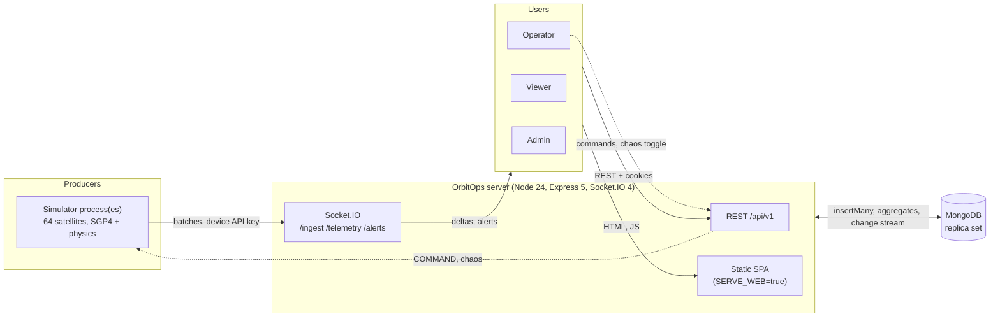
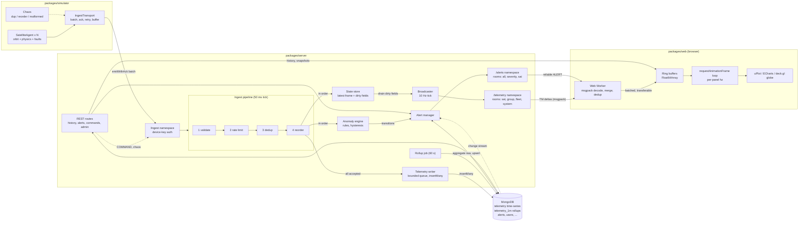
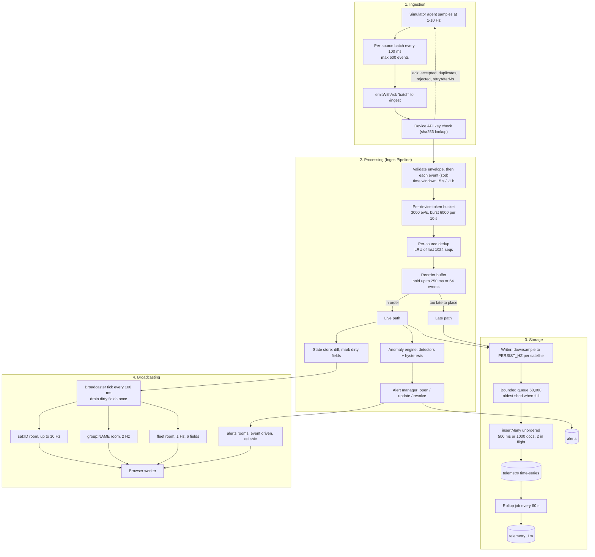
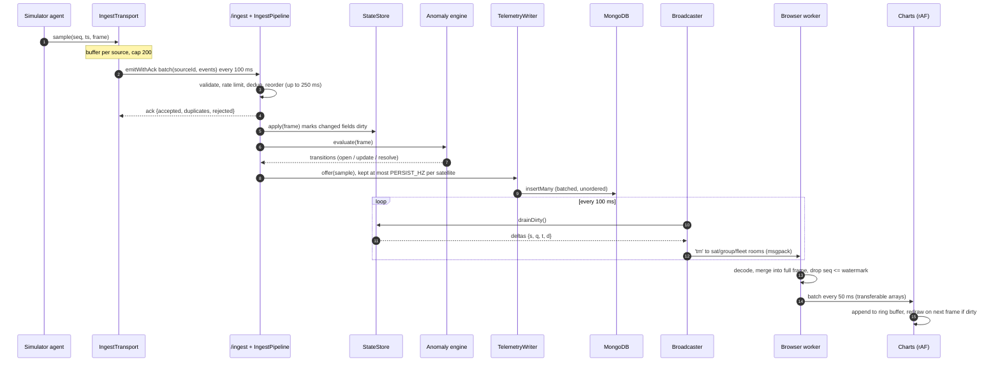

# Architecture

OrbitOps has four moving parts: simulated spacecraft that produce telemetry, a Node server that validates,
processes, stores and broadcasts it, MongoDB for history, and a React single-page app that renders it. The
server is one process serving REST, Socket.IO and the built web app from a single origin. This document shows
how the pieces connect and why they were built this way.

## System context

External data: the simulator ships with a committed snapshot of real orbital elements (CelesTrak) and the
locations of 16 real ground stations. Nothing else is fetched at run time. See [SIMULATION.md](SIMULATION.md).

## Component diagram

## Monorepo layout

npm workspaces; every package is ESM and TypeScript in strict mode. `@orbitops/shared` exports its TypeScript
source directly, so there is no separate build step for it. The server and simulator run through `tsx`; the web
app is built with Vite.

| Path                                                                                                                                           | Purpose                                                                                                                                                          |
| ---------------------------------------------------------------------------------------------------------------------------------------------- | ---------------------------------------------------------------------------------------------------------------------------------------------------------------- |
| [packages/shared](../packages/shared)                                                                                                          | Contracts used by every package: zod schemas, event names, rooms, the compact field codec, the msgpack Socket.IO parser, LTTB downsampling, constants            |
| [packages/server](../packages/server)                                                                                                          | Express 5 + Socket.IO + Mongoose 9. Subfolders: `ingest`, `state`, `anomaly`, `alerts`, `store`, `jobs`, `ws`, `http`, `auth`, `metrics`, `db`, `models`, `seed` |
| [packages/simulator](../packages/simulator)                                                                                                    | Virtual satellites (orbit, physics, faults, chaos) that push telemetry to `/ingest`                                                                              |
| [packages/web](../packages/web)                                                                                                                | React 19 SPA; the client real-time layer lives in [src/realtime](../packages/web/src/realtime)                                                                   |
| [tools/loadtest](../tools/loadtest)                                                                                                            | Ingest flood, viewer-client swarm and scenario runner; results are written up in [PERFORMANCE.md](PERFORMANCE.md)                                                |
| [data](../data)                                                                                                                                | Committed snapshot of real TLEs (`satellites.json`) and ground stations (`ground-stations.json`)                                                                 |
| [Dockerfile](../Dockerfile), [docker-compose.yml](../docker-compose.yml), [compose.app.yml](../compose.app.yml), [render.yaml](../render.yaml) | Container and hosting definitions, see [DEPLOYMENT.md](DEPLOYMENT.md)                                                                                            |
| [.github/workflows/ci.yml](../.github/workflows/ci.yml)                                                                                        | Lint, typecheck, test and web build on every push and pull request                                                                                               |

The composition root is [server.ts](../packages/server/src/server.ts): it builds every service, wires them
together, and starts the HTTP and Socket.IO servers. [index.ts](../packages/server/src/index.ts) only handles
process signals.

## Data flow

The flow has four phases: ingestion, processing, storage and broadcasting. Processing and storage are
decoupled by in-memory structures so that a slow database never blocks live delivery.

Key properties of this design:

- Acknowledgement is decided before anything is written to disk, so the producer is never held up by MongoDB.
- The same drained set of changed fields feeds every room, so the cost of broadcasting does not grow with the
  number of subscriber groups.
- The anomaly engine sees events in sequence order after the reorder buffer, so detectors work on a clean
  signal even in chaos mode.

## Life of one telemetry event

End-to-end latency is measured on real traffic and shown on the System page; see
[REALTIME.md](REALTIME.md#latency-measurement) for how it is computed and
[PERFORMANCE.md](PERFORMANCE.md) for results.

## Key design decisions

Each decision is listed with the reason and the hackathon criterion it serves. The criteria referred to are
those in [the problem statement](MERNIFY_ProblemStatement.pdf).

| Decision                                                                  | Why                                                                                                                                                                                                                                                                                                                                                                    | Serves                                       |
| ------------------------------------------------------------------------- | ---------------------------------------------------------------------------------------------------------------------------------------------------------------------------------------------------------------------------------------------------------------------------------------------------------------------------------------------------------------------- | -------------------------------------------- |
| **MongoDB time-series collection for raw telemetry, plus minute rollups** | Raw samples are write-heavy, append-only and queried by satellite and time range; a time-series collection (meta field `{satId, group}`, time field `ts`) compresses and indexes exactly that shape. Raw data expires after `RAW_TTL_HOURS`; one-minute rollups (avg/min/max) live 30 days, so long-range charts, heatmaps and summaries never scan raw points.        | Historical retrieval, scalable storage       |
| **In-memory dedup and reorder, not unique indexes**                       | MongoDB time-series collections cannot enforce unique indexes. A per-source LRU window of the last 1024 sequence numbers is O(1), needs no database round trip, and keeps duplicate handling off the write path. A persisted `{satId, seq}` mark loaded at boot covers restarts. See [DATA_MODEL.md](DATA_MODEL.md#how-duplicates-are-handled-without-unique-indexes). | Duplicate and out-of-order handling          |
| **Dirty-field deltas, short keys, rounded values, msgpack**               | Most fields change little between ticks. Sending only changed fields with 1-2 character keys, rounded to a fixed precision (so sub-precision jitter is not sent), in a MessagePack frame, cuts bytes per update to roughly a fifth of verbose JSON (measured sample in [REALTIME.md](REALTIME.md#delta-encoding)).                                                     | Latency, throughput, bandwidth               |
| **Socket.IO rooms with per-room rates**                                   | Clients subscribe only to what they show: `sat:ID` at up to 10 Hz, `group:NAME` at 2 Hz, `fleet` at 1 Hz with nine fields. The server computes one delta set per tick and fans it out, so cost scales with rooms, not with clients times satellites.                                                                                                                   | Selective broadcasting, namespaces and rooms |
| **Explicit slow-consumer guard, reliable alerts**                         | Telemetry emits are normal (Socket.IO's `volatile` drops every packet after the first per flush, which broke multi-room clients); a client that cannot keep up is downgraded to the 1 Hz fleet feed and then kicked, so no stale queue builds. Alerts are rare and must not be lost, so they use normal reliable emits and are re-synced over REST after a reconnect.  | Responsiveness, correctness                  |
| **Socket handling in a Web Worker**                                       | Decoding msgpack, merging deltas, deduplicating and measuring latency run off the UI thread. The worker posts one batch every 50 ms with typed arrays as transferables (zero-copy). The UI thread only appends to ring buffers and paints.                                                                                                                             | Client-side performance                      |
| **Ring buffers and one `requestAnimationFrame` loop**                     | Fixed-size `Float64Array` buffers (3000 samples per satellite, about five minutes at 10 Hz) never grow or garbage-collect. A single frame loop calls each panel at its own rate cap and only when its data version changed, so a flood of messages cannot cause a flood of renders.                                                                                    | Preventing excessive rendering               |
| **Bounded queues everywhere**                                             | Writer queue (50,000), simulator buffer (200 per source), per-client send queue (200 packets / 1 MiB), reorder buffer (64). When full, the oldest data is shed and counted, never the newest; alerts are never dropped. Overload becomes a visible metric instead of a crash.                                                                                          | Responsiveness under load                    |
| **Backpressure loop through the ack**                                     | The ingest ack carries `retryAfterMs` when the device is rate limited or the write queue is above 80 % full. The simulator pauses that source and retries, so slowing the producer needs no extra protocol.                                                                                                                                                            | High-throughput ingestion                    |
| **Single origin**                                                         | In production the Express server also serves the built SPA, so REST, Socket.IO and static files share one origin. Cookies are first-party (`SameSite=Lax`, `httpOnly`), no CORS preflights, and one URL to deploy. In development Vite proxies `/api` and `/socket.io` to the server.                                                                                  | Authentication, simple deployment            |
| **Own anomaly engine with hysteresis**                                    | Rolling z-score (Welford), rate-of-change and threshold detectors plus spacecraft-specific rules, with a 3-sample open/clear rule, a clear band and a 60 s re-open cooldown, so alerts do not flap. Rules live in MongoDB and hot-reload when an admin edits them.                                                                                                     | Identifying unusual behaviour                |
| **Simulator is a separate process**                                       | Even when embedded for single-service hosting, the simulator is a child process that connects to `/ingest` with a device key, exactly like an external one. Multiple simulator processes (sharding) are multiple sources.                                                                                                                                              | Multiple data sources, realism               |
| **Change stream for alerts**                                              | Alert writes from another server instance are relayed to local subscribers through a MongoDB change stream (needs a replica set), so a second instance does not break live alerts.                                                                                                                                                                                     | Scalability                                  |

## Limits of the current design

- **One ingest instance.** Dedup windows, reorder buffers, the state store and the anomaly engine are
  in-process. Running several server instances would need either sticky routing of each `sourceId` to one
  instance or moving that state to a shared store. Only alert relay is cross-instance today.
- **Telemetry broadcast is not durable.** Missed deltas are not replayed; reconnecting clients are re-synced
  with snapshots, and history comes from REST.
- **Sockets are authenticated at handshake.** A long-lived socket is not re-checked when its access token
  expires; the web client renews its session whenever a handshake is refused.
