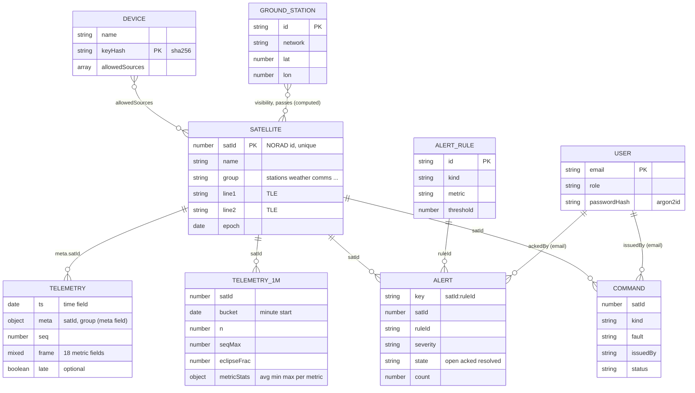

# Data model

OrbitOps stores everything in one MongoDB database. High-volume telemetry goes into a time-series collection
with a short retention, a rollup job condenses it into one-minute summaries that live much longer, and the
remaining collections hold the fleet catalogue, alerts, commands and accounts. This document lists every
collection, its fields, indexes and expiry rules, and explains how duplicates are prevented without unique
indexes.

Source of truth: [db/collections.ts](../packages/server/src/db/collections.ts) (time-series and rollup setup)
and [models/](../packages/server/src/models) (Mongoose schemas). Mongoose collection names are the
lower-cased plural of the model name (`Alert` becomes `alerts`).

## Entity relationships



References are by value (`satId`, `ruleId`, e-mail), not by `ObjectId`. There are no joins in the hot paths;
the server keeps an in-memory [catalogue](../packages/server/src/catalog.ts) of `satId` to name and group.

## Collections at a glance

| Collection       | Kind                | Written by                                                          | Retention                         |
| ---------------- | ------------------- | ------------------------------------------------------------------- | --------------------------------- |
| `telemetry`      | Time-series         | Telemetry writer (native driver)                                    | TTL `RAW_TTL_HOURS` (default 6 h) |
| `telemetry_1m`   | Regular, rollups    | Rollup job                                                          | TTL `ROLLUP_TTL_DAYS` on `bucket` |
| `alerts`         | Regular             | Alert manager, operators                                            | Kept (no TTL)                     |
| `alertrules`     | Regular             | First-boot defaults, admin edits                                    | Kept                              |
| `commands`       | Regular (audit log) | Commands route                                                      | Kept                              |
| `satellites`     | Regular             | Seed from [data/satellites.json](../data/satellites.json)           | Kept                              |
| `groundstations` | Regular             | Seed from [data/ground-stations.json](../data/ground-stations.json) | Kept                              |
| `users`          | Regular             | Seed, admin                                                         | Kept                              |
| `devices`        | Regular             | Seed, admin                                                         | Kept                              |

## `telemetry` (time-series)

Created explicitly at boot, because Mongoose cannot create time-series collections:

```js
db.createCollection('telemetry', {
  timeseries: { timeField: 'ts', metaField: 'meta', granularity: 'seconds' },
  expireAfterSeconds: RAW_TTL_HOURS * 3600,
});
```

If `RAW_TTL_HOURS` changes between runs, the boot step applies the new value with `collMod`.

One document is one telemetry sample. The measurement fields are the 18 fields of the shared
[TelemetryFrame](../packages/shared/src/telemetry.ts) schema, stored flat.

| Field                    | Type                    | Notes                                                                                   |
| ------------------------ | ----------------------- | --------------------------------------------------------------------------------------- |
| `ts`                     | Date                    | Sample time stamped by the producer. The time-series time field.                        |
| `meta.satId`             | number                  | NORAD id. Part of the time-series meta field.                                           |
| `meta.group`             | string                  | One of `stations`, `weather`, `comms`, `earth-obs`, `navigation`, `science`, `amateur`. |
| `seq`                    | number                  | Per-source sequence number; the dedup and history-merge key.                            |
| `late`                   | `true`, optional        | Set when the sample arrived after its slot was already released.                        |
| `lat`, `lon`             | number                  | Degrees, -90..90 and -180..180.                                                         |
| `altKm`, `velKms`        | number                  | Altitude 0..100,000 km; speed 0..15 km/s.                                               |
| `shadow`                 | number                  | Fraction of the solar disc hidden by Earth, 0 sunlit to 1 umbra.                        |
| `solarW`                 | number                  | Array output, W.                                                                        |
| `batSoc`, `batV`, `busA` | number                  | State of charge 0..1, volts, bus current in A.                                          |
| `panelTempC`, `obcTempC` | number                  | Degrees Celsius.                                                                        |
| `rssiDbm`, `snrDb`       | number or null          | Null when no ground station is in view.                                                 |
| `stationId`, `elevDeg`   | string / number or null | Serving station and its elevation; null when out of view.                               |
| `attRateDps`             | number                  | Attitude rate, degrees per second.                                                      |
| `propKg`                 | number                  | Propellant mass.                                                                        |
| `mode`                   | string                  | `NOMINAL`, `SAFE`, `ECLIPSE`, `DEGRADED` or `LOS`.                                      |

Every numeric field is range checked on ingest ([telemetry.ts](../packages/shared/src/telemetry.ts)), so
out-of-range or non-finite values never reach storage.

Example document:

```json
{
  "ts": { "$date": "2026-11-15T09:41:07.300Z" },
  "meta": { "satId": 25544, "group": "stations" },
  "seq": 17640002731,
  "lat": 41.8272,
  "lon": -73.4091,
  "altKm": 421.7,
  "velKms": 7.66,
  "shadow": 0,
  "solarW": 3921.4,
  "batSoc": 0.874,
  "batV": 28.03,
  "busA": 3.58,
  "panelTempC": 52.4,
  "obcTempC": 31.1,
  "rssiDbm": -104.2,
  "snrDb": 21.6,
  "stationId": "WALL",
  "elevDeg": 17.3,
  "attRateDps": 0.05,
  "propKg": 31.42,
  "mode": "NOMINAL"
}
```

The values are illustrative; field names, types and layout match the writer in
[writer.ts](../packages/server/src/store/writer.ts).

**Indexes.** MongoDB maintains its internal time-series index on the meta field and time. The server adds one
more: `{ "meta.satId": 1, "seq": 1 }` (non-unique), used for sequence lookups.

**Downsampling before storage.** The live path runs at the producer's rate (up to 10 Hz), but the writer keeps
at most `PERSIST_HZ` samples per satellite per second (default 2, maximum 10; the Render blueprint uses 1). A
sample is skipped when it is less than `1000 / PERSIST_HZ` ms after the last stored one. The history API
therefore returns at most that resolution for raw ranges.

**Write path.** [TelemetryWriter](../packages/server/src/store/writer.ts) keeps a bounded queue of 50,000
documents. It flushes every 500 ms, or sooner when 1000 documents are waiting, with `insertMany(..., { ordered:
false })`, at most two flushes in flight. If the queue is full the oldest sample is dropped and counted in the
`dropped` metric. On shutdown everything queued is written.

## `telemetry_1m` (minute rollups)

Created by [jobs/rollups.ts](../packages/server/src/jobs/rollups.ts). One document per satellite per minute:

| Field         | Type   | Notes                                                                                                                                     |
| ------------- | ------ | ----------------------------------------------------------------------------------------------------------------------------------------- |
| `satId`       | number | NORAD id.                                                                                                                                 |
| `bucket`      | Date   | Start of the minute (`$dateTrunc`).                                                                                                       |
| `n`           | number | Raw samples aggregated into this document.                                                                                                |
| `seqMax`      | number | Highest `seq` in the minute; the `lastSeq` watermark for rollup history.                                                                  |
| `eclipseFrac` | number | Fraction of samples with `shadow > 0.5`.                                                                                                  |
| `<metric>`    | object | `{ avg, min, max }` for each of: `batSoc`, `batV`, `busA`, `solarW`, `panelTempC`, `obcTempC`, `rssiDbm`, `snrDb`, `attRateDps`, `altKm`. |

```json
{
  "satId": 25544,
  "bucket": { "$date": "2026-11-15T09:41:00.000Z" },
  "n": 120,
  "seqMax": 17640002792,
  "eclipseFrac": 0,
  "batSoc": { "avg": 0.872, "min": 0.869, "max": 0.875 },
  "panelTempC": { "avg": 52.6, "min": 51.9, "max": 53.4 },
  "rssiDbm": { "avg": -104.9, "min": -108.2, "max": -101.7 }
}
```

(`n: 120` is what a 2 Hz stream stores in one minute; at `PERSIST_HZ=1` it is 60.)

**Indexes.** `{ satId: 1, bucket: 1 }` unique, for one-satellite range reads and idempotent upserts; and
`{ bucket: 1 }` with `expireAfterSeconds` from `ROLLUP_TTL_DAYS` (default 30 days), which also serves fleet-wide heatmap scans.

**How rollups are computed.** Every 60 seconds the job re-aggregates the last 3 closed minutes and upserts them
with `$set`. Because it overwrites rather than increments, the job is idempotent: late samples and writer flush
delay are absorbed, and overlapping runs are harmless. At boot it backfills the raw retention window in
one-hour chunks, resuming just before the newest existing rollup.

## `alerts`

One live alert per satellite per rule. Fields mirror the shared [Alert](../packages/shared/src/alerts.ts)
contract, with `Date` values in storage.

| Field                              | Type                                   | Notes                                                                                    |
| ---------------------------------- | -------------------------------------- | ---------------------------------------------------------------------------------------- |
| `key`                              | string                                 | `satId:ruleId`, identifies the live alert.                                               |
| `satId`, `ruleId`                  | number, string                         |                                                                                          |
| `subsystem`                        | `EPS` `TCS` `COMM` `ADCS` `PROP` `OBC` | Owning subsystem.                                                                        |
| `severity`                         | `WARNING` `CAUTION` `ADVISORY`         |                                                                                          |
| `state`                            | `open` `acked` `resolved`              | Lifecycle.                                                                               |
| `message`                          | string                                 | Human-readable description.                                                              |
| `value`, `threshold`               | number or null                         | Triggering value and the limit it crossed.                                               |
| `openedAt`, `lastSeenAt`           | Date                                   |                                                                                          |
| `count`                            | number, min 1                          | Violating samples seen while open.                                                       |
| `ackedBy`, `ackedAt`, `resolvedAt` | optional                               | Set by operator actions or auto-resolution.                                              |
| `instanceId`                       | string, optional                       | Server instance that last wrote it; lets the change-stream listener skip its own writes. |

Indexes: `{ state, severity, openedAt: -1 }`, `{ openedAt: -1 }`, `{ satId, openedAt: -1 }`, `{ key }`.

## `alertrules`

Detection rules, editable by admins. Default set (10 rules) is inserted on first boot from
[domainRules.ts](../packages/server/src/anomaly/domainRules.ts).

| Field                                 | Type                                        | Notes                                                      |
| ------------------------------------- | ------------------------------------------- | ---------------------------------------------------------- |
| `id`                                  | string, unique                              | For example `tcs.panelOverTemp`.                           |
| `name`, `subsystem`, `severity`       |                                             |                                                            |
| `kind`                                | `threshold` `zscore` `roc` `stale` `domain` | Detector type.                                             |
| `metric`                              | string                                      | A telemetry field name.                                    |
| `op`                                  | `>` or `<`                                  |                                                            |
| `threshold`                           | number                                      | For `stale` rules: allowed silence in milliseconds.        |
| `clearRatio`, `samples`, `windowSize` | optional numbers                            | Hysteresis band, consecutive samples, rolling window size. |
| `enabled`                             | boolean                                     |                                                            |

## `commands`

Audit trail of operator commands.

| Field      | Type                                                    | Notes                                        |
| ---------- | ------------------------------------------------------- | -------------------------------------------- |
| `satId`    | number                                                  |                                              |
| `kind`     | `inject_fault` `clear_fault` `safe_mode` `nominal_mode` |                                              |
| `fault`    | `battery` `thermal` `tumble` `comms`, optional          | Required for `inject_fault`.                 |
| `issuedBy` | string                                                  | The operator's e-mail.                       |
| `issuedAt` | Date                                                    |                                              |
| `status`   | `sent` or `no_device`                                   | `no_device` when no simulator was connected. |

Indexes: `{ satId, issuedAt: -1 }`, `{ issuedAt: -1 }`.

## `satellites` and `groundstations`

| Collection       | Fields                                                                                       | Indexes                     |
| ---------------- | -------------------------------------------------------------------------------------------- | --------------------------- |
| `satellites`     | `satId` (unique), `name`, `group`, `line1`, `line2`, `epoch`, timestamps                     | `satId` unique, `group`     |
| `groundstations` | `id` (unique), `name`, `network`, `lat`, `lon`, `altKm`, `minElevDeg`, `loc` (GeoJSON Point) | `id` unique, `loc` 2dsphere |

The seed loads 64 satellites and 16 stations from the committed JSON files. `epoch` is the TLE epoch. Passes
are computed on demand from the TLE and are not stored.

## `users` and `devices`

| Collection | Fields                                                                                          | Indexes          | Security note                             |
| ---------- | ----------------------------------------------------------------------------------------------- | ---------------- | ----------------------------------------- |
| `users`    | `email` (lower-cased), `name`, `passwordHash`, `role` (`viewer` `operator` `admin`), timestamps | `email` unique   | Password stored only as an argon2id hash. |
| `devices`  | `name`, `keyHash`, `allowedSources` (default `["*"]`), `lastSeenAt`, timestamps                 | `keyHash` unique | Only the sha256 of the API key is stored. |

## How duplicates are handled without unique indexes

MongoDB time-series collections cannot carry unique indexes, so uniqueness is enforced before the write, in
three layers:

1. **Per-source dedup window.** [SeqDeduplicator](../packages/server/src/ingest/dedup.ts) remembers the last
   1024 sequence numbers per source in an LRU cache. A repeated `seq` is a duplicate; a `seq` more than 1024
   below the highest seen is also treated as a duplicate because it can no longer be verified. Duplicates are
   counted and acknowledged but never processed or stored.
2. **Reorder buffer.** [ReorderBuffer](../packages/server/src/ingest/reorder.ts) releases events strictly in
   `seq` order (holding up to 250 ms or 64 events for a missing one), so the stored order is monotonic per
   satellite. Events that arrive after their slot was released are marked `late`, and are only stored if they
   fill a real gap in the persisted series.
3. **Boot marks.** At startup [loadBootMarks](../packages/server/src/store/bootMarks.ts) reads the highest
   persisted `seq` and `ts` per satellite. The writer then refuses any sample that is at or below both, so a
   producer replaying its buffer after a server restart does not create duplicates.

A producer restart is detected rather than mistaken for a flood of duplicates: the simulator seeds its first
`seq` from the wall clock (`floor(startMs / 100)`), so a restarted process always starts above anything it sent
before, and the pipeline resets its window when it sees a sequence jump back with a newer timestamp. Details
in [SIMULATION.md](SIMULATION.md#sequence-numbers).

The same `seq` is also the key the browser uses to join history and live data without overlap. See
[REALTIME.md](REALTIME.md#history-and-live-merge).

## Retention summary

| Data                                  | Kept for                         | Controlled by                                              |
| ------------------------------------- | -------------------------------- | ---------------------------------------------------------- |
| Raw telemetry                         | `RAW_TTL_HOURS` (default 6 h)    | Env var; collection TTL                                    |
| Raw resolution                        | `PERSIST_HZ` samples/s/satellite | Env var (default 2)                                        |
| Minute rollups                        | `ROLLUP_TTL_DAYS` (default 30)   | [collections.ts](../packages/server/src/db/collections.ts) |
| Alerts, commands, catalogue, accounts | Indefinitely                     | No TTL                                                     |

History queries over two hours or less read raw data; longer ranges (up to 31 days) read rollups, but rollups
only exist for the period raw data covered, so the longest window with real data is bounded by when the server
first ran and by the rollup TTL.
