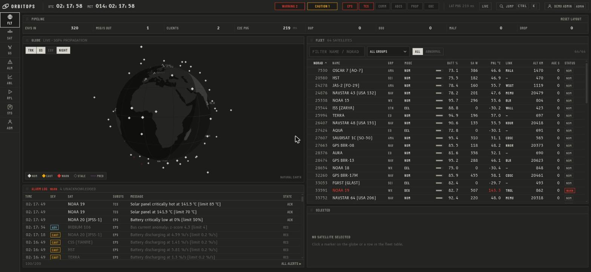
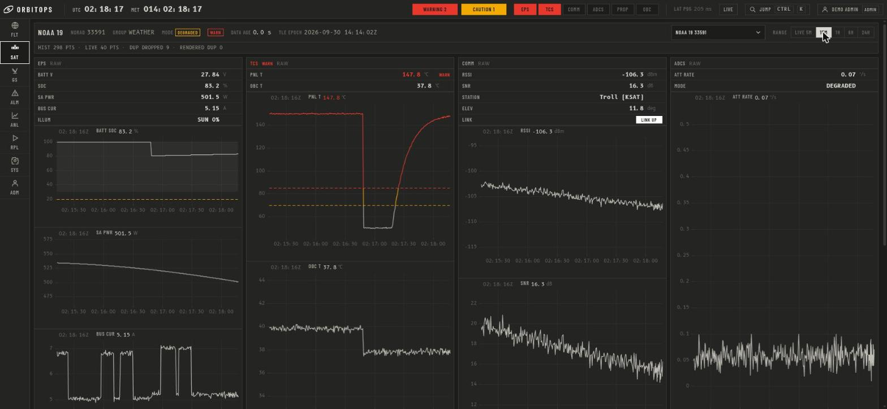
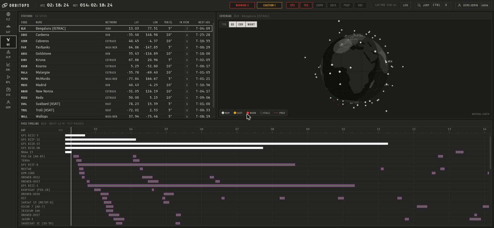
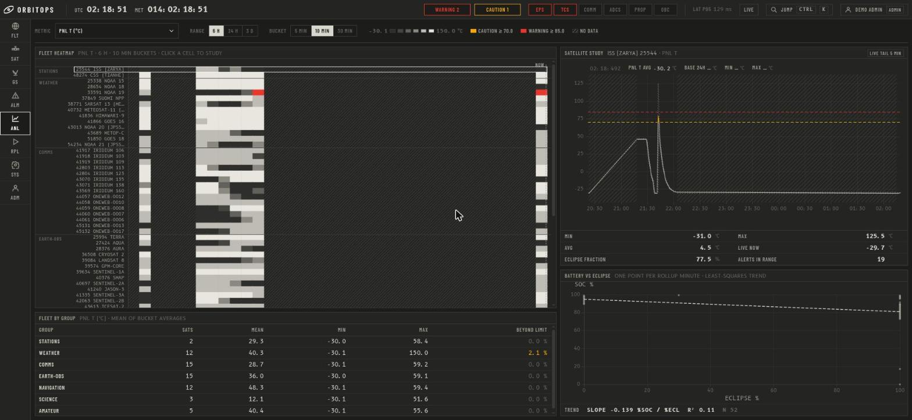
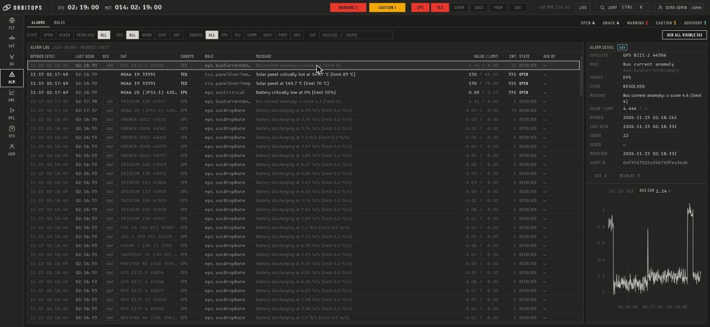
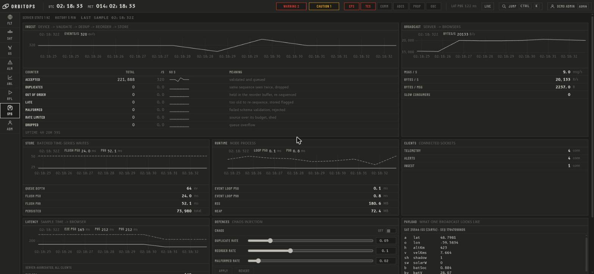

# UI design system: "Grey Room"

The OrbitOps interface is a calm, warm-grey operations console in which **colour means something is wrong**.
This document explains why it looks the way it does, lists the tokens and components, and describes how each page
is laid out. The tokens live in [theme.css](../packages/web/src/styles/theme.css) and the components in
[src/ui](../packages/web/src/ui).

## Why a grey room

Most dashboards colour everything: green for good, blue for brand, a gradient for decoration. When everything is
coloured, nothing stands out, and an operator scanning forty tiles cannot see the one that matters.

OrbitOps follows the opposite rule, taken from industrial control rooms and aircraft cockpits:

- **ISA-101 high-performance HMI.** The guidance for process-control screens says normal operation should be shown
  in muted greys and colour kept for abnormal conditions. An abnormal value then appears as the only coloured thing
  on a grey screen, which the eye finds in a fraction of a second.
- **Cockpit alerting conventions (FAA, Airbus).** A small fixed set of alert colours, with red reserved for
  conditions that need immediate action and amber for conditions that need awareness. Master lamps, subsystem
  annunciators, and flashing that stops when the crew acknowledges.
- **Instrument, not a web page.** Fixed-position labels, dense rows, tabular numbers and no decoration. The screen
  should feel like a console you read, not an app you browse.

Design influences are credited as inspiration only; no code or assets were taken from them (see the README).

### What the design deliberately avoids

Gradients, glow or neon, glass blur, soft drop shadows, rounded cards, coloured card stripes, purple or indigo
accents, big-number tiles with tiny captions, emoji, stock icon packs, bouncing hover effects, decorative pulsing
dots, and Tailwind's default palette. The theme file resets Tailwind's colours, radii, shadows and type scale, so
only the tokens below exist and nothing else can be used by accident.

## Palette

Defined once in [theme.css](../packages/web/src/styles/theme.css) and mirrored for canvas and chart code in
[charts/tokens.ts](../packages/web/src/charts/tokens.ts), which cannot read CSS classes.

| Token       | Hex       | Meaning                                                                               |
| ----------- | --------- | ------------------------------------------------------------------------------------- |
| `bg`        | `#1C1D1B` | Page background, the "room"                                                           |
| `panel`     | `#242522` | Panel and toast surface, one step lighter than the room                               |
| `rule`      | `#3A3B37` | 1px rules, borders, land on the globe                                                 |
| `grid`      | `#2E2F2C` | Chart grid lines, graticule, selected row tint                                        |
| `text`      | `#D8D6CE` | Primary text and nominal values                                                       |
| `text-2`    | `#9A988F` | Labels, secondary text, past tracks                                                   |
| `text-dim`  | `#62615B` | Units, disabled and stale values, hatching                                            |
| `trace`     | `#BEBCB4` | Chart traces in the normal range                                                      |
| `warning`   | `#F6574A` | WARNING: needs action now; critical limit crossed                                     |
| `caution`   | `#F2A900` | CAUTION: needs attention; caution limit crossed; reconnecting                         |
| `advisory`  | `#6FB6C6` | ADVISORY: information worth noting (for example a statistical anomaly)                |
| `predicted` | `#D04FD0` | Predicted or non-live: predicted ground tracks, commanded values, REPLAY mode         |
| `select`    | `#FFFFFF` | Selection, focus ring and primary action. White, not a hue, so it never implies state |

Rules of use:

- Only the four state colours (warning, caution, advisory, predicted) are chromatic. Everything else is a grey
  from the table above.
- Colour is never the only signal. Every coloured state also carries a text code (`WARN`, `CAUT`, `ADV`, `STALE`,
  `DEG`, `ECL`) so the interface still works for colour-blind users and in monochrome screenshots.
- Multi-series charts that must not imply state use [four greys](../packages/web/src/charts/tokens.ts)
  (`GREY_SERIES`), and the heatmap uses a dark-to-light grey ramp.

## Typography

| Role                       | Font                       | Where                                                                  |
| -------------------------- | -------------------------- | ---------------------------------------------------------------------- |
| Interface text             | **B612**                   | Names, messages, table text, buttons                                   |
| Numbers and timestamps     | **B612 Mono**              | Every value, clock, count and chart axis (`.num` utility)              |
| Mnemonics and panel titles | **Barlow Condensed**, caps | Fixed-position labels such as `BATT V`, `SA PWR`, `RSSI` (`.mnemonic`) |

Why B612: it was designed by Airbus with the Paris Design Lab for aircraft cockpit displays, with shapes chosen to
keep similar characters distinct at a glance and to stay readable on small, dense screens. That is the same job
this console does. B612 Mono keeps digit columns aligned, and Barlow Condensed gives caps labels that sit in
narrow columns without shouting. Fonts are self-hosted through Fontsource (SIL Open Font License), so the app
needs no external font request.

Scale: 10, 11, 12 (default), 13, 16 and 24 px. Mnemonics use 0.08em letter spacing. Numbers always use tabular
figures (`font-variant-numeric: tabular-nums`) so a changing value never shifts its neighbours, and units are drawn
in the dim tone so the digits lead.

## Layout grammar

- **Rules, not cards.** The only container is the `Panel`: a 1px-ruled rectangle with a caps title bar. No shadows,
  no nested boxes, corners 0 or 2 px at most.
- **8 px grid.** `--spacing` is 8 px; a dense table row is 24 px (`h-3`); half steps (4 px) are allowed for tight
  clusters. Panels snap to a drag-and-resize grid.
- **Rows, not tiles.** Telemetry is shown as `LABEL ........ value unit` rows in a fixed order, so an operator
  learns where each channel is and scans down a column. Positions never move when values change.
- **Mnemonics.** Three- and four-letter caps labels (`EPS`, `TCS`, `COMM`, `ADCS`, `PROP`, `OBC`) name subsystems
  and channels consistently across tables, charts, alarms and annunciators.
- **UTC everywhere.** The console shows UTC and mission elapsed time (MET) in segment-style clocks, never local time.
- **Text-first states.** Loading, empty and error states are a hatched block and a caps line such as
  `ACQUIRING SIGNAL`, not spinners or illustrations.
- **Own glyph set.** 16 px icons on a square grid with square caps and mitred joins, defined once as an SVG sprite,
  so they match engineering-drawing line work rather than a stock pack.

## Alarm states and annunciators

Severities follow cockpit and ISA-18.2 practice: **WARNING** (red, act now), **CAUTION** (amber, attend),
**ADVISORY** (cyan-grey, note).

| State                     | Lamp / row appearance                                                                                                          |
| ------------------------- | ------------------------------------------------------------------------------------------------------------------------------ |
| Clear                     | Dark window, dim legend, grey rule                                                                                             |
| Active and unacknowledged | Lamp flashes between solid fill with dark legend and dark window with coloured legend, at **1 Hz in hard steps** (never eased) |
| Active and acknowledged   | Steady lit; stops flashing but stays lit while the condition lasts                                                             |
| Resolved                  | Row dims to grey in the alarm log and keeps its text code                                                                      |

- **Master WARNING and CAUTION lamps** sit in the console bar on every page and show the count of unacknowledged
  alarms. Clicking one opens the alarm list filtered to that severity.
- **Subsystem strip** (`EPS TCS COMM ADCS PROP OBC`) rolls the same alarms up per subsystem, lit with the worst
  active severity, so the operator sees which system is in trouble before reading any text.
- **Flash until acknowledged.** Acknowledging changes the state, not just the look: it is recorded on the server and
  every other signed-in window updates.
- **Sound** is optional and off by default. WARNING repeats a two-tone every three seconds while unacknowledged;
  CAUTION gives a single chime. Tones are generated with oscillators, so there are no audio files.
- **Toasts** are restyled to the same flat panel, with a coloured border for severity and the text code inside.
- **Link badge.** `LIVE` is plain grey (normal means no colour), `RECONNECTING` flashes amber, `OFFLINE` is red and
  `REPLAY` is magenta because replayed data is not live.
- **Stale data** is hatched and dimmed with a dash, never left showing an old number as if it were current.

## Chart conventions

Charts are uPlot strip charts ([StripChart.tsx](../packages/web/src/charts/StripChart.tsx)); the heatmap and
scatter views use ECharts with a registered `greyroom` theme.

- **Grey traces.** A trace in its normal range is neutral grey.
- **Normal band.** The expected range is a faint filled band behind the trace (for example battery 20 to 100 %).
- **Dashed limits.** Caution (amber) and warning (red) limits are dashed horizontal lines, drawn only where a
  limit exists.
- **Out-of-limit segments are coloured.** Only the part of the trace beyond a limit turns amber or red, so you see
  exactly when and for how long it was out of range (see the panel temperature in the satellite screenshot below).
- **Hatched gaps.** Where samples are missing (spacing over five seconds by default), the chart draws a hatched
  no-data span instead of joining the points with a misleading line.
- **Minimum span scaling.** Auto-ranging never zooms in closer than a per-channel minimum span, so sensor noise on a
  steady channel stays visually quiet instead of filling the plot.
- **UTC time axes** with a cursor legend that shows the exact time and values.
- **Precision.** Values in legends use the same per-channel decimals as the tables.
- **Redraw discipline.** Charts are created once and only receive new data on the shared frame loop; React does not
  re-render per sample.

## Motion

- Motion is for data, not decoration. Values change colour with an **80 ms linear** transition; panels and tables do
  not slide, scale, fade in or bounce.
- The only animation is the **1 Hz hard-step flash** for unacknowledged alarms and the amber flash of
  `RECONNECTING`. No pulsing dots, no spinners.
- Drag-and-resize of panels has no transition; the drop target is a dashed magenta outline.

## Accessibility

- **Contrast** (measured against the `bg` token): primary text 11.6:1, secondary text 5.9:1, grey trace 8.9:1,
  caution 8.4:1, advisory 7.4:1, predicted 4.6:1, white selection 16.9:1, `warning` red 5.1:1 (4.7:1 on `panel`; the red was lightened from an earlier
  `#E8372C`, which measured 4.0:1, to meet WCAG AA). One exception is known: `text-dim` is 2.7:1. It is used only
  for units and disabled or stale values, which are redundant with an adjacent readable value or code. Colour is
  never the only signal: every alarm colour is paired with a text code (WARN, CAUT, ADV).
- **Not colour alone.** Every state has a text code, hatching or a position cue.
- **Focus.** Every focusable element gets a 1 px white outline with a 2 px offset (`:focus-visible`).
- **Keyboard.** Page hotkeys (`g` then `f`, `s`, `g`, `a`, `n`, `r`, `y`, `d`), a command palette on `Ctrl+K` or
  `Cmd+K`, and keyboard navigation in the fleet table. Dialogs, menus, tabs, tooltips and selects are built on
  Radix primitives, which provide roles, focus handling and arrow-key support.
- **Screen readers.** Lamps and badges have labels such as "WARNING unacknowledged", clocks use `role="timer"`, and
  link status uses `role="status"`.
- **Reduced motion.** With `prefers-reduced-motion`, flashing stops and an unacknowledged element gets a solid
  2 px white outline instead, so the "needs attention" cue survives without motion. Non-data transitions are
  disabled.
- **Layout.** On narrow windows the fleet page switches to a single column with drag and resize turned off.

## Component inventory

The kit in [src/ui](../packages/web/src/ui) is imported from one barrel (`import { ... } from '../ui'`).

| Component                                   | Role                                                                                                           |
| ------------------------------------------- | -------------------------------------------------------------------------------------------------------------- |
| `Panel`                                     | The only container: 1px rule, caps title, optional subtitle, controls and drag grip; title shows state         |
| `Readout`                                   | One `LABEL value unit` row; grey nominal, coloured with a text flag when abnormal, hatched when stale          |
| `Table`, `THead`, `TBody`, `TR`, `TH`, `TD` | Dense 24 px rows, sticky caps header, right-aligned tabular numbers; pairs with virtual scrolling              |
| `Lamp`                                      | Annunciator lamp with the flash-until-acknowledged behaviour                                                   |
| `Tag`, `StatusChip`, `SeverityChip`         | Text-code chips (`NOM`, `CAUT`, `WARN`, `STALE`, `ADV`); stale is hatched                                      |
| `ConnectionBadge`                           | `LIVE`, `RECONNECTING`, `OFFLINE`, `REPLAY`                                                                    |
| `SegmentDisplay`                            | Segment-style digits over a faint ghost "8" layer, for UTC and MET clocks                                      |
| `Button`                                    | Flat, 1px border, caps label; variants default, primary (white border), danger (red), ghost; optional key hint |
| `Tabs`, `SegmentedControl`, `Switch`        | Range pickers, view tabs and toggles (Radix)                                                                   |
| `Field`, `Input`, `Select`                  | Form controls with a mnemonic label, hint and error line                                                       |
| `Dialog`, `Menu`, `Tooltip`                 | Overlays, flat and rule-bordered (Radix)                                                                       |
| `LoadingState`, `EmptyState`, `ErrorState`  | Text-first feedback blocks                                                                                     |
| `Icon`, `IconSprite`                        | Custom glyph set referenced from one inline sprite                                                             |
| `Kbd`                                       | Key cap for shortcut hints                                                                                     |

Charts ([src/charts](../packages/web/src/charts)): `StripChart` (uPlot) and `EChart` (ECharts with only the chart
types in use registered to keep the bundle small). Shell ([src/layout](../packages/web/src/layout)): console bar,
nav rail, mission clocks, annunciators, command palette.

## Pages

The shell is the same everywhere: a 40 px **console bar** across the top (product mark, UTC and MET clocks, master
WARNING and CAUTION lamps, the six subsystem lamps, p95 event-to-screen latency, link badge, command-palette
button, user menu) and a 64 px **navigation rail** on the left with a glyph over a three-letter mnemonic for each
page.

### FLT: Fleet overview

A grid of draggable, resizable panels whose layout is remembered in the browser. A **pipeline strip** across the top
shows live ingest health: events in, messages out, clients, p95 latency, and the duplicate, out-of-order,
malformed and dropped counters. Below it the **globe** (deck.gl, positions propagated in the browser from the
satellites' orbital elements, with track, ground-station, coverage and night toggles) sits beside the **fleet table**
(NORAD id, name, group, mode, battery bar and percent, solar watts, panel temperature, link station, altitude,
data age, status; sortable and filterable). The **alarm log** is at the bottom, and a **selected satellite** panel
takes the details of whatever is clicked. In the screenshot, NOAA 19 is the only coloured row: its panel
temperature and status are red.

### SAT: Satellite detail

The header gives identity, mode, data age and, in small caps, the history and live point counts and duplicates
dropped. The body is one column per subsystem (`EPS`, `TCS`, `COMM`, `ADCS`), each a block of readouts above its
strip charts. A range selector runs from the live five minutes to 24 hours. Operators also get a **Commands**
panel (fault type, inject with confirmation, clear, safe mode, nominal mode). The screenshot shows a thermal fault:
the panel temperature trace sits at its limit, drops after the fault is cleared, and is amber and red only where
it crossed the dashed limits.

### GS: Ground stations

A table of the 16 stations with network, position, minimum elevation, how many satellites are in view and a
countdown to the next pass, next to a coverage globe. Under both is a **pass timeline** for the selected station:
one row per satellite over the next 12 hours, with a white bar for a pass in progress and grey-violet bars (the
"predicted" colour) for future passes.

### ANL: Analytics

The **fleet heatmap** shows one metric for every satellite across time buckets, grouped by satellite group, on a
grey ramp, with hatching where there is no data and red only for cells beyond the warning limit. Clicking a cell
opens the **satellite study**: the metric's trace for that satellite against its own 24-hour baseline, plus
min, max, average, eclipse fraction and alert count for the range. Below are a per-group summary table and a scatter
of battery state of charge against eclipse fraction with a least-squares trend line.

### ALM: Alerts

A filterable alarm log (state, severity, subsystem, satellite) with a summary line of open, unacknowledged and
per-severity counts. Unacknowledged rows are bright; resolved rows are dimmed. The right-hand detail panel shows
the rule, message, value against limit, timestamps, acknowledgement and a context chart of the underlying channel.
Operators acknowledge one alert or all visible ones; a second tab lists the alert rules, which admins can edit.

### RPL: Replay

A time machine over the last six hours: a timeline with coverage, transport controls (step, play, pause, speed)
and the globe and charts driven by the scrubber. The link badge turns magenta (`REPLAY`) while the page is open.

### SYS: System

The pipeline's own instrument panel, refreshed at 1 Hz: ingest events per second with accepted, duplicate,
out-of-order, late, malformed, rate-limited and dropped counters; store queue depth and flush times; event-loop lag
and memory; connected sockets; end-to-end latency percentiles measured in the browser; a **payload** view that
shows what one broadcast message contains; and the **chaos** controls (admin only) that inject duplicates,
reordering and malformed events.

### Onboarding tour

A guided tour of the console (13 steps for an admin, 12 for an operator, 11 for a viewer) starts once after a
user's first sign-in and can be replayed with `shift+?`, from the `Ctrl+K` palette, or from the user menu. It is
built on react-joyride but drawn entirely with the system's own pieces: the tooltip is a 1 px `rule`-bordered
`panel` with a Barlow Condensed caps title, B612 body, a "STEP 03 / 11" counter in B612 Mono and the flat `Button`
(BACK, NEXT, SKIP TOUR, DONE). The overlay is the `bg` token at 70% with a 1 px white (`select`) outline around the
target, square corners and no glow, blur, shadow or arrow. There is **no beacon**: it is a pulsing dot, which the
design bans, so each step opens directly as a tooltip. The only motion is an 80 ms scroll to bring the target into
view, and none under `prefers-reduced-motion`. The tooltip is a `role="dialog"` that takes focus, closes on `Esc`, and
sits above the panels and console bar but below toasts. Steps point only at controls the user's role can use, so
viewers never see the commands or chaos steps. The code lives in
[src/features/tour](../packages/web/src/features/tour); targets are `data-tour` attributes, not CSS classes.

### ADM: Administration

Admin only. Users (create, change role) and device API keys (create, revoke; the plaintext key is shown once).

### Login

A console sign-on screen on the same grey ground. The left side carries the system identity, live clocks and a
legend of what the console's colours mean (the lamps and status codes), so the colour rule is taught before the
first alarm. The right side is the credentials form, with one-click buttons for the three demo roles and a caps
status line for errors.
