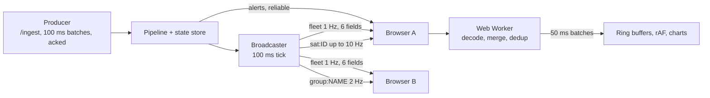
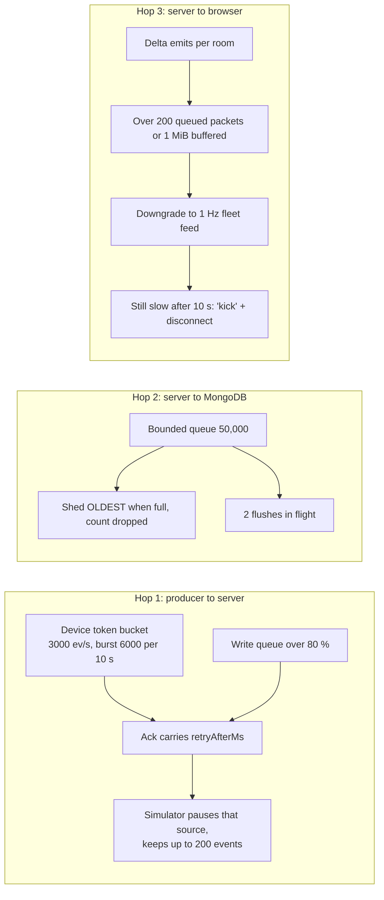
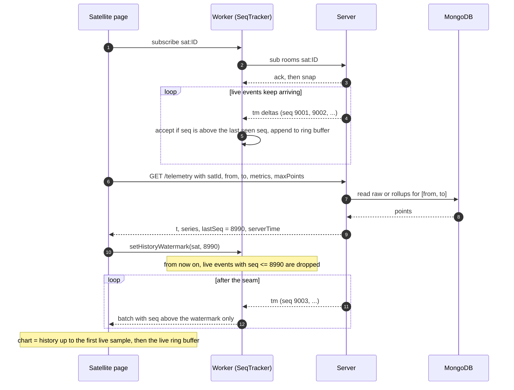
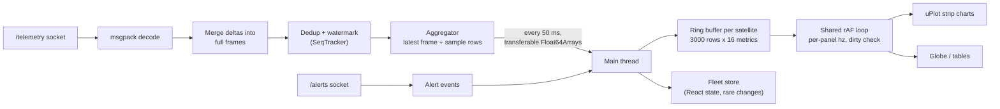

# Real-time communication

OrbitOps moves telemetry from producers to browsers with Socket.IO, and keeps every hop bounded so that a
burst, a slow client or a slow database degrades gracefully instead of failing. This document explains the
subscription model, the broadcast tick, how updates are encoded, how backpressure works at each hop, how
history and live data are merged without duplicates, and what the browser does with the stream. A checklist
at the end maps every optimisation to its code.

## Overview



Three Socket.IO namespaces keep concerns apart ([API.md](API.md#socketio) lists every event):

| Namespace    | Audience          | Direction                            | Delivery       |
| ------------ | ----------------- | ------------------------------------ | -------------- |
| `/ingest`    | Simulator devices | Telemetry in; commands and chaos out | Acknowledged   |
| `/telemetry` | Browsers          | Snapshots and deltas out             | Guarded deltas |
| `/alerts`    | Browsers          | Alert events out                     | Reliable       |

## Subscription model

A browser never receives data it did not ask for. After connecting, the client sends `sub` with the rooms it
wants and, optionally, a rate:

```text
client -> server   sub { rooms: ["fleet", "sat:25544"], hz: 10 }     (ack: { ok: true, rooms: [...] })
server -> client   snap [ full state of every subscribed satellite ]  (once, right after the ack)
server -> client   tm   [ deltas ... ]                                (from then on, every tick)
```

What the server enforces ([subscriptions.ts](../packages/server/src/ws/subscriptions.ts),
[rooms.ts](../packages/shared/src/rooms.ts)):

- Room names must match a strict grammar (`fleet`, `system`, `sat:<id>`, `group:<name>`, `alerts:all`,
  `alerts:sev:<severity>`, `alerts:sat:<id>`) and belong to the namespace. Anything else is `invalid_room`.
- At most 50 rooms per client (`too_many_rooms`).
- At most 20 subscription changes per 10-second sliding window (`rate_limited`), so a buggy or hostile client
  cannot churn the room table.
- `hz` must be 1, 2, 5 or 10.

The first message after subscribing is a **snapshot** (every field), so a new client does not have to wait for
fields to change before it can draw a complete frame. Every later message is a **delta**.

On the client, components do not talk to the socket. They call
[`useSubscription(rooms, hz)`](../packages/web/src/realtime/useRealtime.ts), which goes through a ref-counted
[SubscriptionManager](../packages/web/src/realtime/subscriptionManager.ts). It merges requests from many
components, coalesces React StrictMode and route-change churn into one tick, snaps the rate up to an allowed
value, and sends only net changes. The app shell always holds `fleet` at 1 Hz and `alerts:all`; a satellite
page adds `sat:<id>`.

## Rooms and rates

| Room         | Rate                                         | Fields                                                                                 | Why                                     |
| ------------ | -------------------------------------------- | -------------------------------------------------------------------------------------- | --------------------------------------- |
| `sat:<id>`   | 10 Hz, or the connection's `hz` of 1, 2 or 5 | All changed fields                                                                     | Detail views need smooth traces         |
| `group:<g>`  | 2 Hz                                         | All changed fields, merged                                                             | Group tables and filtered views         |
| `fleet`      | 1 Hz                                         | `lat`, `lon`, `altKm`, `batSoc`, `mode`, `shadow`, `solarW`, `panelTempC`, `stationId` | Globe and fleet table for 64 satellites |
| `system`     | 1 Hz                                         | `PipelineStats`                                                                        | System page                             |
| alerts rooms | On change                                    | `Alert`                                                                                | Operators must see alerts immediately   |

The rates are constants in [constants.ts](../packages/shared/src/constants.ts) (`BROADCAST_HZ = 10`,
`GROUP_HZ = 2`, `FLEET_HZ = 1`). The fleet view shows 64 moving points; sending six fields once per second
instead of all 18 fields ten times per second is roughly a 30x reduction for that view.

## The broadcast tick

[Broadcaster](../packages/server/src/ws/broadcaster.ts) runs one timer at 100 ms. Each tick:

1. Checks every client for backpressure (see below).
2. Drains the [state store's](../packages/server/src/state/store.ts) dirty fields **once**. Between ticks the
   pipeline marks only the fields whose rounded value changed; the drain turns them into one delta per
   satellite and clears the marks. A field that changed five times within a tick is sent once, with its latest
   value.
3. Emits each delta to its `sat:<id>` room.
4. For clients that asked for less than 10 Hz, merges deltas into a per-socket pending map and sends it when
   that client's interval has elapsed. Merging keeps the latest value per field and the newest `seq`.
5. Every 500 ms, sends the accumulated per-group merges to the `group:*` rooms.
6. Every 1000 ms, sends the accumulated fleet merge (six fields) to `fleet`.

Because all rooms are fed from the same drained set, adding a subscriber costs a socket write, not another
computation. Socket.IO also encodes a room broadcast once and writes the same frame to every member. Slow and
low-rate clients are excluded from the room emit with `except` so they are served separately.

## Delta encoding

Three techniques shrink every update ([codec.ts](../packages/shared/src/codec.ts)):

1. **Deltas.** Only changed fields are sent. A snapshot is the same shape with every field.
2. **Short keys.** Each of the 18 fields has a 1-2 character key (`batSoc` is `b`, `panelTempC` is `tp`). The
   table is in [API.md](API.md#compact-delta-keys).
3. **Fixed rounding.** Values are rounded per field (latitude to 4 decimals, temperature to 1, and so on)
   _before_ they are compared. A change smaller than the display precision is therefore not a change, and is
   not sent.

The packets are then framed as **MessagePack** by a small custom Socket.IO parser
([socketParser.ts](../packages/shared/src/socketParser.ts)) that both server and clients pass as
`{ parser }`. It sends every packet as one binary frame, validates the decoded structure strictly (packet
type, namespace, id and data shape), and drops the connection on malformed input.

Measured on 599 consecutive samples of the first satellite in the bundled catalogue at 10 Hz (a one-off
measurement with the real codec and simulator, not a benchmark):

| Representation                                      | Average bytes per sample |
| --------------------------------------------------- | ------------------------ |
| Full frame, long keys, JSON                         | 470                      |
| Full frame, short keys, MessagePack                 | 194                      |
| Delta (about 6.6 of 18 fields changed), MessagePack | 105                      |
| Complete Socket.IO packet carrying one such delta   | 137                      |

That is about 78 % fewer bytes than verbose JSON per update, before counting the larger saving from not
sending unchanged samples at all. At the lower rates a simulator normally runs (1-5 Hz) more fields change per
delta, so the saving per message is smaller but the message count is lower. See [PERFORMANCE.md](PERFORMANCE.md)
for end-to-end bandwidth under load.

## Delivery guarantees

| Traffic                 | Delivery          | Reason                                                                                                                          |
| ----------------------- | ----------------- | ------------------------------------------------------------------------------------------------------------------------------- |
| `tm` deltas, `stats`    | Normal + guarded  | Bounded by explicit backpressure: a client whose buffer grows is downgraded to the 1 Hz fleet feed, then kicked (see below)     |
| `snap` snapshots        | Normal            | Sent once per subscribe; needed for correctness                                                                                 |
| `alert`, `alert:update` | Normal (reliable) | Rare and important; replayed after a short disconnect by connection state recovery, and re-fetched over REST after a longer one |
| `batch` (ingest)        | Acknowledged      | The producer must know what was accepted                                                                                        |

Telemetry deliberately does **not** use Socket.IO's `volatile` flag. A volatile packet is dropped whenever the
socket is still flushing the previous one, so a client subscribed to several rooms (for example `fleet` plus
`sat:25544`) only received the first packet of each tick. Instead every emit is a normal one, and the
slow-consumer guard below keeps a struggling client from building an unbounded queue: it is the explicit,
per-client version of what `volatile` tried to do globally.

## Backpressure and slow consumers

Backpressure is applied at every hop, and in each case the policy is the same: bound the buffer, drop the
oldest data first, count it, and tell the sender to slow down where possible.



**Producer to server.** The ack tells the producer how to behave. When the per-device token bucket is
exhausted (3000 events/s sustained, 6000 extra per 10 s by default), the ack is `{ ok: false, retryAfterMs }`
and nothing is processed. When the write queue is more than 80 % full, accepted batches are acknowledged with
`retryAfterMs: 250`. The simulator's [transport](../packages/simulator/src/transport.ts) pauses that source
until the delay has passed, keeps the unsent events (at most 200 per source; beyond that the oldest are dropped
and counted), retries after an ack timeout of 2 s, and discards events from its buffer only once they are
acknowledged.

**Server to MongoDB.** [TelemetryWriter](../packages/server/src/store/writer.ts) holds at most 50,000 samples.
When full it sheds the oldest, so the newest data always wins, and exposes the count as `dropped`. Alerts are
written through a separate path and are never shed. At most two `insertMany` flushes run at once.

**Server to browser.** Every tick, [evaluateConsumer](../packages/server/src/ws/backpressure.ts) inspects each
client's Engine.IO write buffer and the WebSocket's `bufferedAmount`.

| Condition                                                | Action                                                                                                                                        |
| -------------------------------------------------------- | --------------------------------------------------------------------------------------------------------------------------------------------- |
| More than 200 queued packets or more than 1 MiB buffered | **Downgrade**: pending merges are discarded, the client stops receiving `sat` and `group` emits and gets only the 1 Hz fleet payload directly |
| Load back under both thresholds                          | **Recover**: normal service resumes                                                                                                           |
| Still overloaded 10 s after the downgrade                | **Kick**: the server emits `kick { reason: "slow_consumer" }` and disconnects                                                                 |

The web worker treats `kick` specially: it is not an authentication failure, so it waits 2 seconds and
reconnects. The number of downgraded clients is exposed as `slowConsumers` in the stats.

## Connection state recovery

The server enables Socket.IO [connection state recovery](https://socket.io/docs/v4/connection-state-recovery)
with a 2-minute window ([io.ts](../packages/server/src/ws/io.ts)). A client that reconnects within it keeps its
rooms and receives the reliable packets (alerts) it missed.

Missed telemetry is never replayed (only alerts are), so for a recovered `/telemetry` connection the server immediately sends
fresh snapshots for its rooms ([telemetryNamespace.ts](../packages/server/src/ws/telemetryNamespace.ts)).

Longer outages, or a server restart, give a normal reconnect. The web worker re-sends all its subscriptions on
every `connect` (which also restores the requested rate, since the per-connection rate resets), and after the
connection returns the main thread reloads alerts over REST, because REST is the source of truth for anything
missed while offline.

## History and live merge

A chart wants the last few minutes of history _and_ a live edge, with no gaps and no duplicated points. The
server and client cooperate through a single number, the **sequence watermark** `lastSeq`.



The rules, all verified by tests ([server integration](../packages/server/src/api.integration.test.ts),
[seqTracker.test.ts](../packages/web/src/realtime/seqTracker.test.ts),
[telemetryStore.test.ts](../packages/web/src/realtime/telemetryStore.test.ts)):

1. **Subscribe first.** Live events start filling the ring buffer immediately, so nothing that happens during
   the history request is lost.
2. **`lastSeq` is exact.** The server computes it as the highest `seq` of all stored points in the requested
   range, before downsampling. It is `-1` when the range is empty. For rollup responses it is the highest
   `seqMax` of the rolled-up minutes.
3. **The watermark filters the future.** The worker keeps, per satellite, the highest of all watermarks it has
   been given and drops live deltas with `seq <= watermark`. Events above it were not yet stored (the writer
   batches and downsamples), so keeping them leaves no gap.
4. **The time cut handles the past.** Samples that arrived before the watermark was set may overlap the history
   response. When the chart reads its data, the
   [WindowReader](../packages/web/src/realtime/telemetryStore.ts) uses history only for times before the first
   live sample, so the overlap is resolved in favour of live data.
5. **Independent duplicate defence.** The worker also drops any delta whose `seq` is not above the last one it
   accepted for that satellite, so a duplicate delivered by the network or replayed after recovery is never
   drawn. A sequence that jumps back by more than 1024 is treated as a producer restart and the tracker resets.
   Snapshots always refresh the latest frame but only count as a new chart sample when they are ahead of
   everything seen.
6. **Sequence numbers are monotonic across producer restarts**, which is what makes comparing them safe (see
   [SIMULATION.md](SIMULATION.md#sequence-numbers)).

The worker keeps counters for accepted deltas, duplicates, events below the watermark and restarts
(`getStats()`), which prove the dedup is working during a demo with [chaos mode](SIMULATION.md#chaos-mode) on.

Because the writer stores at most `PERSIST_HZ` samples per second, history is coarser than the live edge
(2 Hz by default against up to 10 Hz live). The seam is still gap-free; the trace simply gets denser at the
right edge.

## The browser pipeline



- **Web Worker.** [socket.worker.ts](../packages/web/src/realtime/socket.worker.ts) owns both sockets. Decoding,
  delta merging, dedup, time sync and latency accounting happen off the UI thread, so a burst of messages cannot
  stall input or painting. The main thread talks to it through Comlink.
- **Batching.** The [aggregator](../packages/web/src/realtime/aggregator.ts) accumulates the latest merged frame
  per satellite and, only for satellites with a `sat:` subscription, the sample rows. Every 50 ms the worker
  posts one batch. Sample columns are `Float64Array`s sent as transferables, so they move to the main thread
  without copying.
- **Ring buffers.** [RingBuffer](../packages/web/src/realtime/ringBuffer.ts) holds 3000 rows per satellite (about
  five minutes at 10 Hz), allocated lazily. Every row is written twice, at `i` and `i + capacity`, so the
  oldest-to-newest window is always one contiguous slice and reading it for a chart is a zero-copy `subarray`.
  A version counter bumps on each write.
- **One frame loop.** [frameLoop.ts](../packages/web/src/realtime/frameLoop.ts) runs a single
  `requestAnimationFrame` that exists only while something is registered. Each panel registers a callback with
  its own rate cap (a strip chart defaults to 10 Hz; `useLatest` defaults to 2 Hz). A callback compares the
  store's version with the one it last drew and returns early if nothing changed, so rendering work scales with
  _changes_, not with messages.
- **Rare React updates.** High-rate data lives outside React. The fleet store publishes per-satellite status
  (NOMINAL, CAUTION, WARNING, STALE) at most every 500 ms, and a satellite is STALE after 15 s without a frame.

## Latency measurement

The system measures how old a sample is when it reaches the browser, using an NTP-style clock estimate
([latency.ts](../packages/web/src/realtime/latency.ts)):

1. Every 10 s the worker sends `time` and records the send time `t0`. The server acknowledges with its
   `Date.now()` (`ts`); the ack arrives at `t1`.
2. Assuming the server stamped its clock at the midpoint of the round trip, the offset is
   `ts - (t0 + t1) / 2`. The worker keeps the last 8 samples and uses the offset from the one with the smallest
   round-trip time, which is least distorted by queueing.
3. For each accepted live delta, latency is `Date.now() + offset - sampleTs`, where `sampleTs` is the `t` the
   producer stamped. The last 2000 values are kept.
4. Every 5 s the worker computes p50, p95 and p99, resets the window, and sends them to the server as `lat`.
   The same numbers (plus the offset) are shown in the UI, which also uses the offset for mission clocks.
5. The server keeps each client's latest report for 30 s and publishes a sample-weighted mean of the clients'
   percentiles as `latency` in `PipelineStats` (the System page and `orbitops_latency_*` Prometheus gauges).
   This is an average of percentiles, an approximation of a fleet-wide percentile rather than an exact one.

What it includes and excludes: it covers producer stamp, ingest, reorder hold (up to 250 ms), the broadcast
tick, any per-client coalescing and the network, up to the moment the worker accepts the delta. It does not
include the 50 ms worker batching or the paint. It also assumes the producer's clock and the server's clock
agree, which holds for the bundled single-host deployments; with a remote producer, clock skew shows up as
latency.

## Performance optimisation checklist

| Technique                                                        | Where                                                                                                                          |
| ---------------------------------------------------------------- | ------------------------------------------------------------------------------------------------------------------------------ |
| Producer-side batching (100 ms, max 500 events)                  | [transport.ts](../packages/simulator/src/transport.ts), [constants.ts](../packages/shared/src/constants.ts)                    |
| Per-event validation (one bad event does not drop a batch)       | [validate.ts](../packages/server/src/ingest/validate.ts)                                                                       |
| Per-device token bucket                                          | [rateLimit.ts](../packages/server/src/ingest/rateLimit.ts)                                                                     |
| O(1) per-source dedup (LRU of 1024 seqs)                         | [dedup.ts](../packages/server/src/ingest/dedup.ts)                                                                             |
| Bounded reorder buffer (250 ms or 64 events)                     | [reorder.ts](../packages/server/src/ingest/reorder.ts)                                                                         |
| Latest state in memory with dirty-field tracking                 | [store.ts](../packages/server/src/state/store.ts)                                                                              |
| Delta, short keys and rounding                                   | [codec.ts](../packages/shared/src/codec.ts)                                                                                    |
| MessagePack binary framing                                       | [socketParser.ts](../packages/shared/src/socketParser.ts)                                                                      |
| One drain per tick feeding all rooms                             | [broadcaster.ts](../packages/server/src/ws/broadcaster.ts)                                                                     |
| Per-room rates and delta coalescing (10 / 2 / 1 Hz)              | [broadcaster.ts](../packages/server/src/ws/broadcaster.ts), [coalesce.ts](../packages/server/src/ws/coalesce.ts)               |
| Per-client rate (1, 2, 5, 10 Hz) and merged batches              | [clients.ts](../packages/server/src/ws/clients.ts), [subscriptions.ts](../packages/server/src/ws/subscriptions.ts)             |
| Slow-consumer guard instead of volatile emits                    | [broadcaster.ts](../packages/server/src/ws/broadcaster.ts)                                                                     |
| Slow-consumer downgrade and kick                                 | [backpressure.ts](../packages/server/src/ws/backpressure.ts)                                                                   |
| Subscription limits (50 rooms, 20 changes per 10 s)              | [subscriptions.ts](../packages/server/src/ws/subscriptions.ts)                                                                 |
| Message size cap (256 KiB)                                       | [io.ts](../packages/server/src/ws/io.ts)                                                                                       |
| Ack-based backpressure (`retryAfterMs`)                          | [pipeline.ts](../packages/server/src/ingest/pipeline.ts), [transport.ts](../packages/simulator/src/transport.ts)               |
| Downsampled persistence (`PERSIST_HZ`)                           | [writer.ts](../packages/server/src/store/writer.ts)                                                                            |
| Bounded write queue, unordered `insertMany`, 2 flushes in flight | [writer.ts](../packages/server/src/store/writer.ts)                                                                            |
| Time-series collection with TTL                                  | [collections.ts](../packages/server/src/db/collections.ts)                                                                     |
| Idempotent minute rollups                                        | [rollups.ts](../packages/server/src/jobs/rollups.ts)                                                                           |
| LTTB downsampling of history                                     | [lttb.ts](../packages/shared/src/lttb.ts), [history.ts](../packages/server/src/store/history.ts)                               |
| Cached pass predictions (LRU)                                    | [passes.ts](../packages/server/src/http/routes/passes.ts)                                                                      |
| Event-loop, flush and queue metrics (`/metrics`, `stats`)        | [collector.ts](../packages/server/src/metrics/collector.ts), [prometheus.ts](../packages/server/src/metrics/prometheus.ts)     |
| Connection state recovery with snapshot resync                   | [io.ts](../packages/server/src/ws/io.ts), [telemetryNamespace.ts](../packages/server/src/ws/telemetryNamespace.ts)             |
| Socket work in a Web Worker                                      | [socket.worker.ts](../packages/web/src/realtime/socket.worker.ts)                                                              |
| 50 ms batches of transferable typed arrays                       | [aggregator.ts](../packages/web/src/realtime/aggregator.ts)                                                                    |
| Zero-copy mirrored ring buffers                                  | [ringBuffer.ts](../packages/web/src/realtime/ringBuffer.ts)                                                                    |
| Single rAF loop with per-panel rate caps and dirty checks        | [frameLoop.ts](../packages/web/src/realtime/frameLoop.ts), [telemetryStore.ts](../packages/web/src/realtime/telemetryStore.ts) |
| Ref-counted, coalesced subscriptions                             | [subscriptionManager.ts](../packages/web/src/realtime/subscriptionManager.ts)                                                  |
| Client-side dedup and history watermark                          | [seqTracker.ts](../packages/web/src/realtime/seqTracker.ts)                                                                    |
| Throttled React state (status at 2 Hz)                           | [fleetStore.ts](../packages/web/src/realtime/fleetStore.ts)                                                                    |
| Lazy-loaded routes                                               | [router.tsx](../packages/web/src/router.tsx)                                                                                   |

Measured results for these techniques under load are in [PERFORMANCE.md](PERFORMANCE.md).

## Known limitations

- The `hz` a client requests is one setting per connection, not per room. If two panels request different rates
  for different satellites, the most recent `sub` wins for all of the connection's `sat:*` rooms.
- Tokens are checked at handshake time. A connected socket is not disconnected when its access token expires
  or its account is deleted; the next handshake is refused.
- `chaos` is a plain string event name defined separately in the server and the simulator, not a shared
  constant like the other event names.
