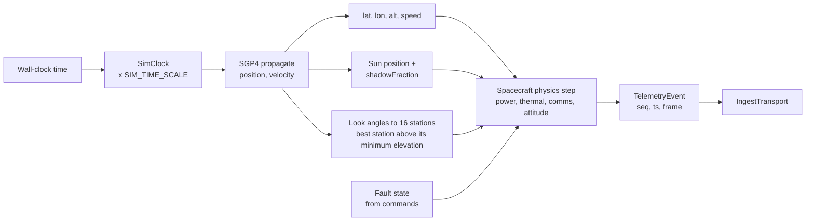

# Simulation

OrbitOps has no physical hardware, so its data source is a simulator: 64 virtual spacecraft that fly real
orbits from published orbital elements and report physically plausible telemetry. The orbits and ground
stations are real; the housekeeping values (power, temperatures, link quality) come from a small, transparent
model. This document explains what is simulated, how, how faults and chaos mode work, and where the data
comes from.

Code: [packages/simulator/src](../packages/simulator/src).

## What is simulated

| Aspect                                     | Real or modelled                                                                                                                          |
| ------------------------------------------ | ----------------------------------------------------------------------------------------------------------------------------------------- |
| Orbits                                     | **Real.** Two-line element sets (TLEs) propagated with the SGP4 model, using [satellite.js](https://github.com/shashwatak/satellite-js) 7 |
| Sun and eclipse                            | **Computed.** Sun position and a conical umbra/penumbra shadow model from satellite.js (`sunPos`, `shadowFraction`)                       |
| Ground stations                            | **Real sites**, 16 of them across KSAT, ESTRACK, NASA NEN, DSN and ISRO, at approximate public coordinates                                |
| Visibility                                 | **Computed** from look angles between each satellite and each station                                                                     |
| Power, thermal, link, attitude, propellant | **Modelled.** Simple physics with per-satellite parameters seeded from the NORAD id                                                       |
| Faults                                     | **Injected** by operator commands                                                                                                         |

Spacecraft telemetry from real operators is not public, which is why the housekeeping channels are modelled.
Everything that determines _when_ things happen (position, sunlight, which station is in view) is real.

The fleet is the 64 satellites in [data/satellites.json](../data/satellites.json):

| Group       | Count             | Group        | Count |
| ----------- | ----------------- | ------------ | ----- |
| `earth-obs` | 15                | `navigation` | 12    |
| `comms`     | 15                | `amateur`    | 5     |
| `weather`   | 12                | `science`    | 3     |
| `stations`  | 2 (ISS, Tiangong) |              |       |

## How a sample is produced

One timer in [index.ts](../packages/simulator/src/index.ts) fires `SIM_HZ` times per second and asks every
[SatelliteAgent](../packages/simulator/src/agent.ts) for a sample. Each sample does this:



- If SGP4 cannot propagate a satellite (decayed or invalid elements) the agent returns no sample for that tick.
- `SIM_TIME_SCALE` makes orbits and physics run faster than real time, which is useful for watching eclipses and
  passes quickly. Event timestamps always stay on the wall clock, so the server's time-window check still holds.
- Per-satellite parameters (load, solar array size, battery capacity, thermal time constants, link offset,
  initial charge and propellant) are derived from the NORAD id with a seeded generator
  ([prng.ts](../packages/simulator/src/prng.ts)), so every run looks the same for the same satellite.

## The physics model

All equations are in [physics.ts](../packages/simulator/src/physics.ts). `dt` is the simulated time since the
previous sample in seconds, `shadow` is 0 (full sun) to 1 (full umbra), and `noise(s)` is Gaussian noise with
standard deviation `s`.

**Power**

```text
solarW   = solarMaxW x (1 - shadow) x attitudeFactor x panelDegradation
loadW    = baseLoadW x (safeMode ? 0.4 : 1)  +  occasional payload spike (35 % of base load)
netW     = solarW - loadW
energyWh = (netW > 0 ? netW x 0.92 : netW / 0.97) x dt / 3600        (charge / discharge efficiency)
batSoc  += energyWh / capacityWh            (then clamped to 0..1)
batV     = 24 + 4.6 x batSoc + noise(0.03)
busA     = loadW / batV + noise(0.05)
```

`attitudeFactor` varies slowly between 0.7 and 1.0 for a healthy satellite. The array is sized so a typical
eclipse costs 15-25 % of the battery, which gives the state of charge a visible sawtooth over an orbit. Payload
spikes arrive on average every 90 s and last 8-20 s (never in safe mode).

**Thermal.** Temperatures follow a first-order lag toward a target, using the exact exponential step
`T <- T + (target - T) x (1 - exp(-dt / tau))`, which stays stable for any `dt`:

```text
panelTarget = -30 + (panelHotC - -30) x (1 - shadow)          tau = 240-480 s (per satellite)
obcTarget   = obcBaseC + 6 x (1 - shadow) + 8 x loadW / (1.35 x baseLoadW)    tau = 900-1500 s
```

Measured values add small noise (0.3 °C panel, 0.15 °C OBC).

**Communications.** Each tick the agent computes look angles to every station and picks the highest one that is
above that station's own minimum elevation (5 or 10 degrees). If there is one:

```text
rssiDbm = clamp(-92 - 20 x log10(range / 500 km) + linkOffset + noise(0.4), -120, -90)
snrDb   = rssiDbm - noiseFloor + noise(0.3)
```

That is free-space loss with -92 dBm at 500 km and 6 dB per doubling of range. With no station in view,
`rssiDbm`, `snrDb`, `stationId` and `elevDeg` are all `null`.

**Attitude and propulsion.** Attitude rate is 0.03-0.07 deg/s plus noise for a healthy spacecraft. Propellant
burns at a constant 2 microgram per second.

**Mode.** `LOS` if the comms fault is active; otherwise `SAFE` if safe mode is on; otherwise `DEGRADED` while a
battery, thermal or tumble fault is active; otherwise `ECLIPSE` when `shadow > 0.5`; otherwise `NOMINAL`.

## Faults and commands

Operators send commands from the UI (`POST /commands`, operator role). The server records them, relays them to
every connected simulator device, and each agent applies the ones addressed to its own satellite
([faults.ts](../packages/simulator/src/faults.ts)).

| Command                 | Effect on the model                                                                                        | What the platform should show                                                                        |
| ----------------------- | ---------------------------------------------------------------------------------------------------------- | ---------------------------------------------------------------------------------------------------- |
| `inject_fault: battery` | State of charge drains an extra 5 % of full charge per simulated second (0.9 to 0.2 in about 14 s)         | `eps.socDropRate`, then `eps.lowSocEclipse` (only in eclipse) and `eps.socCritical`; mode `DEGRADED` |
| `inject_fault: thermal` | Panel temperature is pulled toward 150 °C with a 15 s time constant                                        | `tcs.panelOverTemp` at 70 °C, then `tcs.panelOverTempCritical` at 85 °C; mode `DEGRADED`             |
| `inject_fault: tumble`  | Attitude rate jumps to 3-8 deg/s and the array incidence oscillates with a 5 s period (solar power swings) | `adcs.tumble` (above 2 deg/s), possible bus-current anomaly; mode `DEGRADED`                         |
| `inject_fault: comms`   | RSSI and SNR become `null`; the station and its elevation stay populated (the geometry is unchanged)       | `comm.linkLossInPass` once the station is above 10°; mode `LOS`                                      |
| `clear_fault`           | Removes one fault, or all faults when no fault type is given. Overheated panels cool quickly (20 s)        | Alerts resolve after the clear samples and hysteresis                                                |
| `safe_mode`             | Sheds non-essential load to 40 % of base load and stops payload spikes                                     | Mode `SAFE`; lower bus current                                                                       |
| `nominal_mode`          | Leaves safe mode (does not clear faults)                                                                   | Mode returns to `NOMINAL` or `ECLIPSE`                                                               |

The alert rules and their thresholds are in
[domainRules.ts](../packages/server/src/anomaly/domainRules.ts) and can be tuned by an admin. The comms-loss
rule is gated on a station being in view (an elevation above 10 degrees), so it only fires during a real pass.

A comms fault models a dead transmitter rather than a missing station: the frame still says which station
is in view and at what elevation, but RSSI and SNR are `null`. That combination is exactly what
`comm.linkLossInPass` looks for, so the alert fires during the next pass above 10 degrees.

## Chaos mode

Chaos mode exists to demonstrate that the ingest pipeline is robust. An admin switches it on with
`PUT /system/chaos`; the server pushes the configuration to every simulator device (and to any device that
connects later). Rates are probabilities per event.

| Setting         | Default | What the simulator does to its outgoing batch                                                                                     | Server defence that handles it                                           |
| --------------- | ------- | --------------------------------------------------------------------------------------------------------------------------------- | ------------------------------------------------------------------------ |
| `duplicateRate` | 0.05    | Sends an extra copy of the event                                                                                                  | Dedup window; counted as `duplicates`                                    |
| `reorderRate`   | 0.10    | Swaps the event with the next one, or delays it to a later batch (at most 64 held per source)                                     | Reorder buffer; counted as `outOfOrder` (or `late` if it comes too late) |
| `malformedRate` | 0.02    | Corrupts the event: `NaN` solar power, latitude out of range, a missing field, a string where a number belongs, or a wrong `type` | Validation; counted as `malformed`, reported in the ack's `rejected`     |

Only the copy put on the wire is damaged. The simulator's own buffer stays clean, so retries are not affected,
and the stored data stays consistent. The simulator logs how many of each it injected every 10 s, and the
System page shows the server-side counters, so the two can be compared.

## Sharding and multiple sources

One simulator process can drive the whole fleet, or the fleet can be split across several processes. Each
process connects to `/ingest` on its own, and each satellite is a separate source (`sat-<noradId>`), so
several processes are simply several producers feeding one pipeline.

| Variable    | Meaning                                                                                                |
| ----------- | ------------------------------------------------------------------------------------------------------ |
| `SIM_SATS`  | Comma-separated NORAD ids to simulate; empty means all 64                                              |
| `SIM_SHARD` | `index/count`: this process takes every satellite whose position in the list is `index` modulo `count` |

Example, three processes sharing the fleet:

```bash
SIM_SHARD=0/3 npm run start -w @orbitops/simulator
SIM_SHARD=1/3 npm run start -w @orbitops/simulator
SIM_SHARD=2/3 npm run start -w @orbitops/simulator
```

A command is relayed to all devices; each agent ignores satellites it does not own.

## Sequence numbers

Every event carries a per-source `seq` and a timestamp `ts`. The server uses them to detect duplicates, restore
order and join history with live data, so the scheme matters.

- Each agent's first `seq` is `floor(startMs / 100)`, where `startMs` is the wall-clock time at boot; it then
  increases by one per sample.
- The seed grows by 10 per second, and a sample stream advances at most `SIM_HZ` (at most 10) per second. A
  later process therefore always starts above anything an earlier one sent, so sequence numbers stay monotonic
  **across restarts**, with no persisted counter.
- On the server, a forward jump larger than the reorder buffer's capacity (64) starts a new epoch rather than
  waiting for events that will never arrive, and a fall of more than 1024 behind the high-water mark combined
  with a newer timestamp resets the source's dedup state
  ([pipeline.ts](../packages/server/src/ingest/pipeline.ts), [reorder.ts](../packages/server/src/ingest/reorder.ts)).
- `ts` is `Math.round` of the wall clock at sampling.

## Transport behaviour

[IngestTransport](../packages/simulator/src/transport.ts) is a Socket.IO client for `/ingest` (WebSocket
transport only, MessagePack parser, device key in the handshake).

- Samples are queued per source. Every 100 ms each source with pending samples sends one batch of at most 500
  events, one batch in flight per source, using `emitWithAck`.
- A successful ack removes the acknowledged events. A rejected ack, or one that times out after 2 s, keeps them
  for retry; `retryAfterMs` pauses that source.
- The buffer is capped at 200 events per source. Beyond that, the oldest are dropped and counted.
- A status line every 10 s reports connection state, send rate, ack outcomes, buffer depth and drops.

## Embedded simulator

On hosts that run a single service (Render's free tier has no free background workers), set
`EMBED_SIMULATOR=true` and the server starts the simulator itself
([embeddedSimulator.ts](../packages/server/src/embeddedSimulator.ts)). It is still a separate operating-system
process: a `tsx` child that connects back to `http://127.0.0.1:<port>` with the device key, exactly like an
external simulator. The server restarts it five seconds after an unexpected exit and stops it on shutdown
(`SIGTERM`, then `SIGKILL` after five seconds). It needs `DEVICE_API_KEY`; without one the server logs a warning
and does not start it. The rate comes from `EMBED_SIMULATOR_HZ` (default 2).

## Configuration

| Variable         | Default                 | Meaning                                                                      |
| ---------------- | ----------------------- | ---------------------------------------------------------------------------- |
| `SERVER_URL`     | `http://localhost:4000` | Server to connect to                                                         |
| `DEVICE_API_KEY` | (empty)                 | Device key; the server refuses the connection without a valid one            |
| `SIM_HZ`         | 5                       | Samples per second per satellite, clamped to 1-10                            |
| `SIM_SHARD`      | `0/1`                   | See above                                                                    |
| `SIM_SATS`       | (all)                   | See above                                                                    |
| `SIM_TIME_SCALE` | 1                       | Simulated seconds per wall-clock second; must be positive                    |
| `TLE_REFRESH`    | `false`                 | When `true`, try to replace each TLE with the live CelesTrak one at start-up |

With `TLE_REFRESH=true` the simulator makes one polite pass over CelesTrak at boot: requests are sequential,
300 ms apart, with a 5 s timeout. The first failure aborts the refresh and the remaining satellites keep their
snapshot elements. It never throws and the simulator starts either way.

## Data sources and attribution

| Data                   | Source                                                                                                                                                                                                                                                                                                                                                                                                                                    |
| ---------------------- | ----------------------------------------------------------------------------------------------------------------------------------------------------------------------------------------------------------------------------------------------------------------------------------------------------------------------------------------------------------------------------------------------------------------------------------------- |
| Orbital elements (TLE) | [CelesTrak](https://celestrak.org) GP data (NORAD two-line elements). The committed snapshot [data/satellites.json](../data/satellites.json) was retrieved on 2026-11-15 through the tle.ivanstanojevic.me mirror, as recorded in the file's `source` field. Elements age: the snapshot's epochs range from September to November 2026, so positions are accurate for the period around the snapshot and drift as the elements get older. |
| Orbit propagation      | satellite.js 7.2.0 (MIT licence), an implementation of the SGP4/SDP4 models                                                                                                                                                                                                                                                                                                                                                               |
| Ground-station sites   | [data/ground-stations.json](../data/ground-stations.json): approximate public locations of real sites (KSAT, ESTRACK, NASA NEN, Deep Space Network, ISRO), compiled for this project. Coordinates are approximate and are used only for visibility and pass prediction                                                                                                                                                                    |
| Telemetry values       | Synthetic, generated by the model above. They are not real spacecraft telemetry                                                                                                                                                                                                                                                                                                                                                           |

Satellite names, NORAD numbers and elements belong to their original publishers; this project only uses them
for visualisation.
